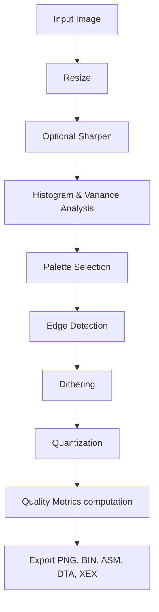

# Atari Image Converter

A high-quality image converter to translate modern formats (PNG, JPG, BMP, GIF) into Atari 8-bit graphics (specifically targeting **ANTIC Mode E**).

This project is designed from the ground up as a highly modular, professional-grade image processing pipeline. It aims to surpass standard quantization/dithering utilities (like Pillow, ImageMagick, GIMP, or pngquant) for retro computing purposes by incorporating specialized perception-driven quantization, local variance analysis, and adaptive dithering.

---

## Features

- **Input Support:** PNG, JPG, BMP, and GIF.
- **Target Mode:** ANTIC Mode E (160×192, 2 bits per pixel, 4 colors including background).
- **Extensible Pipeline:** Fully decoupled stages for loading, resizing, sharpening, histogram/variance analysis, palette selection, edge detection, dithering, quantization, metrics computation, and exports.
- **Adaptive Dithering:** Analyzes local image detail, variance, and edges to choose the optimal dithering method per-pixel (e.g., using ordered dither on smooth gradients, error diffusion on detailed areas, and disabling dither on sharp edges to avoid color bleeding).
- **Quality Metrics:** Built-in calculation of MSE, PSNR, SSIM, RGB/Luminance errors, and histogram coverage.
- **Visual Previews:** Generates side-by-side comparisons, upscale previews (2x, 4x), and pixel-level error heatmaps.

---

## Installation

Ensure you have Python 3.12+ installed. Clone this repository, navigate to the directory, and install in editable mode with development dependencies:

```bash
python -m pip install -e ".[dev]"
```

This installs dependencies such as `numpy`, `Pillow`, `pytest`, and `ruff`.

The desktop GUI is optional and needs PySide6, which ships as the `gui` extra:

```bash
python -m pip install -e ".[gui]"        # the GUI alone
python -m pip install -e ".[dev,gui]"    # the GUI plus the development tools
```

The CLI never imports PySide6, so `python -m converter` keeps working without the extra (the GUI tests
then skip themselves). See [GUI Application](#gui-application).

---

## Usage

You can run the tool using the CLI wrapper [convert.py](file:///c:/Users/grzes/Documents/Projects/py-image-converter/convert.py).

You can also run it as a Python module:

```bash
python -m converter input.png output.bin
```

Equivalent module form:

```bash
python -m converter.main input.png output.bin
```

### Basic Conversion
Convert an image to a raw Atari `.bin` file (which is the default format):
```bash
python convert.py input.png output.bin
```

### Specifying Export Formats
The output format can be automatically inferred from the extension of your output file. You can also explicitly request formats using the `--export` option (repeat for multiple):
```bash
python convert.py input.png output --export png --export xex --export asm
```

Supported export formats:
- **`png`**: Reconstructed visual image mapped to the Atari palette.
- **`bin`**: Raw ANTIC Mode E screen data.
- **`asm`** / **`s`**: Assembler directives containing raw bytes.
- **`dta`**: Raw data output format.
- **`xex`**: Executable Atari program file.

### CLI Parameters

| Option | Choices / Format | Default | Description |
| :--- | :--- | :--- | :--- |
| `input` | Path | (Required) | Path to input image (PNG/BMP/GIF/JPG). |
| `output` | Path | (Required) | Base output path. |
| `--width` | Integer | `160` | Output width. |
| `--height` | Integer | `192` | Output height. |
| `--mode` | `ANTIC_E` | `ANTIC_E` | Atari hardware display mode. |
| `--palette` | `popularity`, `kmeans`, `median_cut`, `octree`, `perceptual` | `popularity` | Algorithm used to select the 4-color Atari palette. |
| `--colors` | Integer | `4` | Number of output colors. |
| `--dither` | `none`, `floyd`, `jarvis`, `stucki`, `sierra`, `sierra_lite`, `burkes`, `atkinson`, `bayer2`, `bayer4`, `bayer8`, `adaptive` | `floyd` | Dithering algorithm. |
| `--quantizer` | `nearest`, `perceptual`, `weighted`, `adaptive` | `nearest` | Color matching and quantization method. |
| `--resize` | `nearest`, `bilinear`, `bicubic`, `lanczos` | `lanczos` | Image resizing algorithm. |
| `--sharpen` | Flag | `False` | Apply an unsharp mask post-resize. |
| `--sharpen-strength` | Float | `1.0` | Strength of the sharpening effect. |
| `--background-index` | Integer (`0-255`) | `0` | Default Atari color index for the background. |
| `--preview` | Flag | `False` | Generate high-res comparison, upscaled, and error heatmap previews. |
| `--metrics` | Flag | `False` | Compute and display quality metrics. |
| `--export` | `png`, `bin`, `asm`, `dta`, `xex` (repeatable) | (inferred) | Export format. Repeat flag for multiple formats. |
| `--xex`, `-x` | Path | None | Explicit output path for Atari executable preview (.xex). |
| `--antic-mode`, `-m` | `D`, `E`, `F`, `7`, `15`, `8` | (auto) | ANTIC mode for XEX preview. |
| `--atari-colors` | Comma-separated hex | None | Override `COLOR0-COLOR4` (`COLPF0, COLPF1, COLPF2, COLPF3, COLBK`) in XEX/ASM (e.g. `0x00,0x04,0x0a,0x0e`); without it the registers follow the converted palette. |
| `--config` | Path | None | Path to a JSON configuration file to load settings. |
| `--save-config` | Path | None | Path to save current pipeline settings as a JSON config file. |

---

## GUI Application

A PySide6 desktop application wraps the same pipeline: open an image, adjust the parameters and watch the
result. It never re-implements conversion or serialisation - it drives the same engine as the CLI on a
worker thread, so the window stays responsive while a conversion runs.

### Running

Any of these starts the application (see [Installation](#installation) for the `gui` extra):

```bash
atari-convert-gui        # console script installed with the package
python -m converter_gui  # the same entry point as a module
python convert_gui.py    # launcher for a source checkout
```

The CLI stays independent of the GUI: `atari-convert`, `python -m converter` and `python convert.py` never
load Qt.

### What it does

- **Open** an image with *File > Open* (`Ctrl+O`) or drop it onto the window (PNG, BMP, GIF, JPG).
- **Parameters**: a target preset (ANTIC E 160×192 and 160×190, ANTIC D 160×96, ANTIC F 320×192, or
  *Custom*) plus width/height, aspect ratio correction, resize, sharpen and its strength, palette,
  colours, background index, dithering, quantizer, and the five hardware colour registers with their
  *Use converter palette* switch (see [Hardware colour registers](#hardware-colour-registers-xex-and-asm-exports)).
- **Previews**: the resized source and the Atari result side by side, zoomed in 1×/2×/4×/8× steps
  (`Ctrl`+wheel also zooms), panned by dragging, with both views kept in sync. *Fit* scales the image into
  the window; a newly opened image is fitted, while later conversions keep the zoom and position you chose.
  The result view is the **hardware interpretation of the bitmap**: every pixel value is drawn with the
  colour of the GTIA register it selects (`COLBK`, `COLPF0`-`COLPF2`) from the measured PAL palette, in
  the pixel shape of the selected mode (see [Hardware colour registers](#hardware-colour-registers-xex-and-asm-exports)).
  It is what the exported `.xex` will show - no scanlines, no blur, no extra dithering, nearest-neighbour
  zoom; the source view keeps its square pixels and the untouched resized image.
- **Conversions**: *Auto-update* (on by default, 300 ms debounce) reconverts after each parameter change;
  switch it off to convert only when you press *Convert* (`Ctrl+Return`). The badge above the previews and
  the status bar name the state - `ready (gen N)`, `stale - showing gen M`, `updating… (gen N)` or
  `error - still showing gen M` - so an outdated image is never mistaken for the current parameters. A
  failed conversion keeps the last good image and metrics and shows a dismissible one-line error.
- **Diagnostics**: the *Metrics* and *Stage timings* sections start collapsed and open on a click; *Copy*
  puts the whole report (metrics plus per-stage timings) on the clipboard.

### PAL aspect ratio and the preview geometry

Atari pixels are not square, so stretching an image onto the target grid changes the proportions of
everything in it. Two independent things use the same table, and both were measured by rendering an
exported `.xex` in PAL Altirra and reading the emulator's display rectangle (336×240 output shown in a
1.3:1 box, see the comment in `converter/aspect.py`):

| Mode | Grid | Pixel aspect (PAL) | Whole picture |
| :--- | ---: | ---: | ---: |
| ANTIC D | 160 × 96 | 0.93 : 1 (lines doubled) | 1.55 : 1 |
| ANTIC E | 160 × 192 (and 160 × 190) | 1.86 : 1 | 1.55 : 1 |
| ANTIC F | 320 × 192 | 0.93 : 1 | 1.55 : 1 |

Every mode covers the same physical area, so E and F pictures have the same proportions and D is simply
half as tall. **The conversion setting and the preview are separate:** *Correction* decides how the
source is fitted onto the grid, while the preview always draws the result with the pixel shape of the
mode - so `Atari result` matches the emulator even with *Correction: Disabled*.

- *Disabled* (the default) keeps the previous behaviour: the image is stretched onto the whole grid.
- *Preserve Aspect Ratio (Fit)* keeps the whole image and fills the margins with the conversion's
  background colour.
- *Preserve Aspect Ratio (Crop)* fills the grid and trims the image where it overflows.

A *Custom* size has no hardware geometry, so the panel reports that the correction stays off until you
enter a pixel aspect (or pick a preset); such a result is also drawn with square pixels, because no
ANTIC mode displays it. The same settings are available to the CLI through a JSON configuration -
`"aspect": "fit"` or `"crop"` plus an optional `"pixel_aspect": 1.5` - and are simply absent from a
configuration that does not use them.

### Export

*File > Export…* (`Ctrl+E`) writes the displayed result - never a stale one, and only while no newer
conversion is pending - asking for a folder, a file name and a format:

| Format | Extension | Contents |
| :--- | :--- | :--- |
| PNG | `.png` | Reconstructed image mapped to the Atari palette |
| BIN | `.bin` | Raw ANTIC screen data |
| ASM | `.s` | Assembler source with the screen bytes and colour registers |
| DTA | `.dta` | Raw data output |
| XEX | `.xex` | Executable Atari program |

The save dialog only offers the formats the current result can satisfy, using the engine's own
compatibility checks, so an incompatible format is never written: BIN/ASM/DTA need a 160×190 or 160×192
screen with at most four colours, XEX additionally needs a width divisible by its pixels per byte, and PNG
accepts up to 256 colours. The file keeps its format's canonical extension (ASM is always written as `.s`),
and the last folder is remembered for the session.

### Keyboard shortcuts

| Shortcut | Action |
| :--- | :--- |
| `Ctrl+O` | Open an image |
| `Ctrl+Return` | Convert now |
| `Ctrl+E` | Export the displayed result |
| `Ctrl+Q` | Close the application |
| `Ctrl`+wheel | Zoom the preview through 1×/2×/4×/8× |

### Known limitations

- One conversion runs at a time: a newer request cancels the running one between stages, and Export stays
  disabled until the displayed result matches the settings again.
- One format per export. The ANTIC mode for XEX is inferred from the image shape (the CLI's `--antic-mode`
  has no GUI equivalent yet), and preview images (`--preview`) and a custom ASM label are CLI-only.
- Sizes outside the presets are possible (*Custom*), but the Atari formats then refuse to export until the
  result matches what the hardware can display.
- Only PAL is modelled (no PAL/NTSC switch), and a *Custom* size needs an explicit pixel aspect before the
  correction does anything - the panel says so instead of guessing a factor.
- A *Custom* size that matches no ANTIC mode cannot be exported as `.xex`; the *Atari result* view then
  falls back to the converter's own palette colours, because there is no hardware interpretation to show.

Implementation details and the responsiveness measurements live in
[docs/GUI_IMPLEMENTATION_PLAN.md](docs/GUI_IMPLEMENTATION_PLAN.md) and
[docs/GUI_PERFORMANCE.md](docs/GUI_PERFORMANCE.md).

---

## Hardware colour registers (XEX and ASM exports)

The Atari has no RGB palette: a colour is a byte with a hue (high nibble) and a luminance (low nibble),
so the RGB colours of a conversion have to be matched to the 256 hardware colours. The XEX viewer
cannot show anything without those values, which is why the exporters always write them:

- *Use converter palette* (the default in the GUI) maps every colour of the converted palette to the
  nearest measured PAL colour with the CIE94 match of the `rgb2a8` tool and shows the result in the
  section, so what you see is what the `.xex` contains.
- Clearing the checkbox makes the fields editable; those values are written as they are and are never
  overwritten by a new conversion. The *Atari result* view follows both cases immediately - it is
  rendered from exactly these registers, so editing a colour redraws the picture without reconverting.
- The CLI does the same through `--atari-colors` (override) or a JSON configuration; without either
  the registers follow the converted palette.

The data formats keep the converter's own colours (a `.png` is an image file, not a screen): only the
`.xex` viewer, which has to produce the picture on the Atari, and the `Atari result` preview speak in
hardware colours.

`COLOR0` .. `COLOR4` are the OS shadows of `COLPF0`, `COLPF1`, `COLPF2`, `COLPF3` and `COLBK`. Which
palette colour lands where depends on the mode (`docs/XEX_COLOR_REGISTERS.md`):

| Mode | Palette colour 0 | 1 | 2 | 3 |
| :--- | :--- | :--- | :--- | :--- |
| ANTIC D / E | `COLOR4` (COLBK) | `COLOR0` (COLPF0) | `COLOR1` (COLPF1) | `COLOR2` (COLPF2) |
| ANTIC F | `COLOR4` (COLBK, border) | `COLOR1` luminance | `COLOR2` hue + background luminance | – |

Mode F can only display two luminances of one hue, so its mapping keeps the foreground hue and both
luminances. The ASM export writes the same bytes, but only when they are configured explicitly - the
screen data alone is the default output of that format.

---

## Configuration via JSON

Instead of passing extensive command line arguments, you can save and load pipeline settings from a JSON file.

### Loading Configuration
```bash
python convert.py input.png output.xex --config my_config.json
```

### Saving Current CLI Flags to JSON
```bash
python convert.py input.png output.bin --save-config my_config.json --dither adaptive --palette kmeans --preview
```

### Example Config JSON File
```json
{
    "mode": "ANTIC_E",
    "width": 160,
    "height": 192,
    "palette": "kmeans",
    "colors": 4,
    "dither": "adaptive",
    "quantizer": "nearest",
    "resize": "lanczos",
    "sharpen": true,
    "sharpen_strength": 1.2,
    "background_index": 0,
    "preview": true,
    "metrics": true,
    "export": [
        "png",
        "bin",
        "xex"
    ],
    "atari_colors": [0, 4, 10, 14]
}
```

---

## Visual Previews & Heatmaps

If you run with `--preview`, the converter generates a dedicated directory `<output>_preview/` containing:
- `<output>_x2.png` & `<output>_x4.png`: Upscaled renders using nearest-neighbor scaling (preserving retro pixel boundaries).
- `<output>_compare.png`: Side-by-side comparison of the source (resized) image and the Atari conversion.
- `<output>_error.png`: Per-pixel color representation difference heatmap (red indicates high conversion discrepancy, blue indicates low error).

---

## Batch Generation Script (PowerShell)

For generating many conversion variants at once (all palette + dither + resize + quantizer combinations), use `generate-images.ps1`.

### Required Parameters

- `-InputFile`: Input image path.
- `-OutputDir`: Output directory for generated images.
- `-Height`: Output height passed to CLI as `--height`.
- `-Width`: Output width passed to CLI as `--width`.

### Example

```powershell
Set-ExecutionPolicy -Scope Process Bypass
.\generate-images.ps1 -InputFile "C:\temp\image.png" -OutputDir "C:\temp\out" -Height 192 -Width 160
```

The script invokes `python -m converter.main` for each algorithm combination and writes `.png` files to the selected output directory.

---

## Release Automation (GitHub Actions)

This repository includes a workflow at `.github/workflows/release-on-pr-close.yml` that creates a GitHub Release with downloadable `.whl` and `.tar.gz` artifacts whenever a pull request is closed.

## Versioning

Versioning is tag-driven.

- `pyproject.toml` uses dynamic version metadata via `setuptools-scm` (no static `project.version` field).
- The release workflow calculates the next semantic version from existing tags matching `vX.Y.Z`.
- Bump level is inferred from merged PR commit messages:
    - `feat!` or `BREAKING CHANGE` -> major
    - `feat` -> minor
    - `fix` / `perf` / `refactor` / `revert` -> patch
- The workflow creates and pushes the new tag (`vMAJOR.MINOR.PATCH`), then builds and publishes release artifacts from that tag.

### Workflow Summary

- Trigger: `pull_request` with type `closed`.
- Condition: runs only when the PR was merged into `main`.
- Build: sets up Python 3.12 and runs `python -m build`.
- Release: publishes a GitHub Release and attaches `dist/*.whl` and `dist/*.tar.gz`.

Generated release tag format:

```text
v<MAJOR>.<MINOR>.<PATCH>
```

---

## Project Structure & Architecture

```
py-image-converter/
├── pyproject.toml         # Build tool dependencies & project settings
├── convert.py             # Main CLI execution script
├── convert_gui.py         # GUI launcher for a source checkout
├── docs/                  # GUI plan, performance measurements, format notes
└── src/
    ├── converter/
    │   ├── main.py            # CLI argument parsing and configuration orchestration
    │   ├── aspect.py          # PAL pixel aspect ratio correction (geometry stage)
    │   ├── atari_match.py     # RGB -> nearest measured Atari colour (rgb2a8 port)
    │   ├── config.py          # JSON configuration load/save utils
    │   ├── pipeline.py        # Pipeline execution workflow manager
    │   ├── types.py           # Shared data containers and types
    │   ├── image_loader.py    # Reads input images (Pillow wrapper)
    │   ├── resize.py          # Nearest, Bilinear, Bicubic, Lanczos methods
    │   ├── sharpen.py         # Unsharp masking post-processing
    │   ├── histogram.py       # RGB/HSV/Luminance histogram & variance analyser
    │   ├── hardware_colors.py # COLOR0-4 arrangement and the hardware frame renderer
    │   ├── edge_detect.py     # Edge detection (Sobel, Laplacian)
    │   ├── palette.py         # 4-color palette generation (Popularity, Kmeans, Octree, etc.)
    │   ├── atari_palette.py   # Full Atari hardware palette with color specs
    │   ├── quantizer.py       # Pixel assignment algorithms
    │   ├── dithering.py       # Error diffusion & ordered dither execution
    │   ├── metrics.py         # SSE, PSNR, SSIM, Luminance metrics
    │   ├── preview.py         # Generates upscaled comparison images and heatmaps
    │   ├── algorithms/        # Mathematical definitions of dithering masks
    │   └── exporters/         # Exporters for PNG, BIN, ASM, DTA, XEX
    ├── converter_gui/         # PySide6 application (optional "gui" extra)
    │   ├── app.py             # Application start-up and entry point
    │   ├── main_window.py     # Window, actions, layout and controller wiring
    │   ├── exporting.py       # Format table and compatibility checks for Export
    │   ├── imaging.py         # NumPy -> QImage conversion
    │   ├── targets.py         # ANTIC target presets
    │   ├── limits.py          # Size and colour limits shared by the widgets
    │   ├── controllers/       # Debounce, generations, pending export intent
    │   ├── workers/           # QThreadBackend and the ConversionBackend protocol
    │   └── widgets/           # Preview, parameter panel, metrics, collapsible sections
    └── tests/                 # Unit, integration and GUI test suite
```

---

## Pipeline Flow



---

## Testing

This project uses `pytest` for unit and integration testing. Run the entire suite with:

```bash
pytest
```