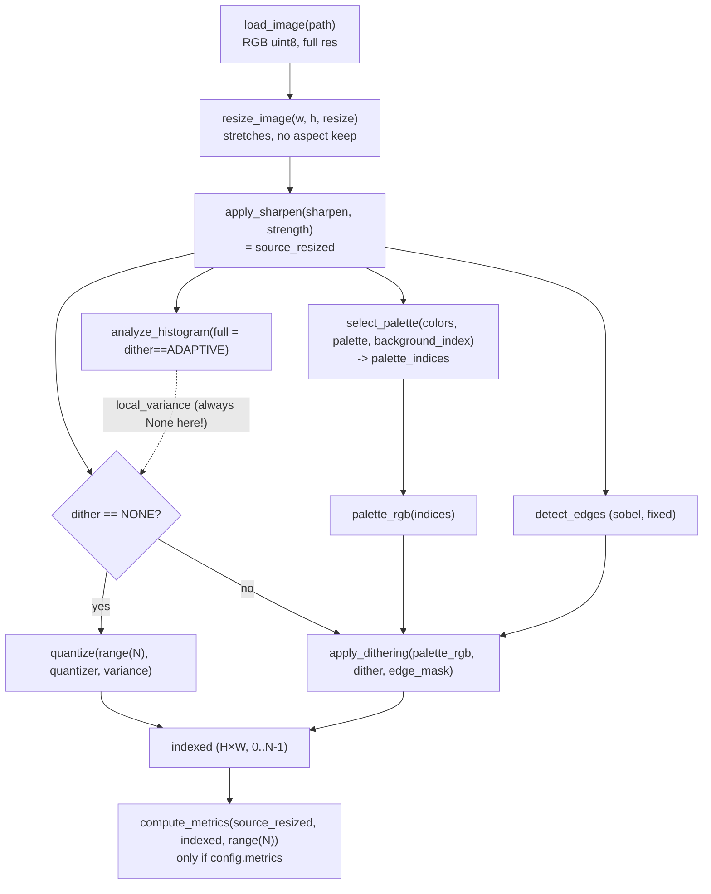
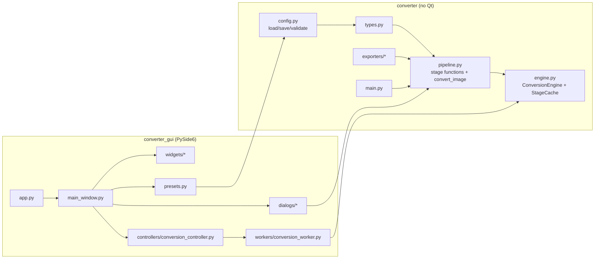
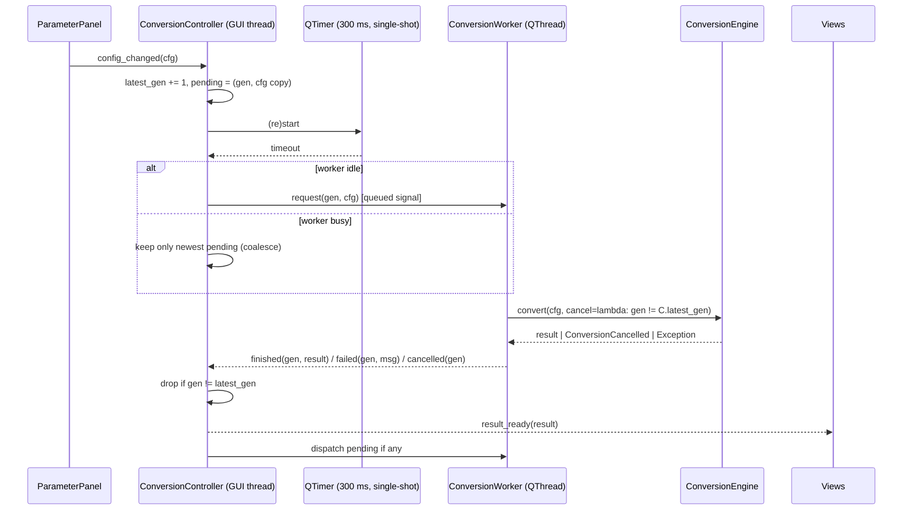
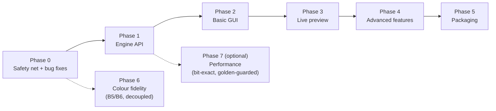
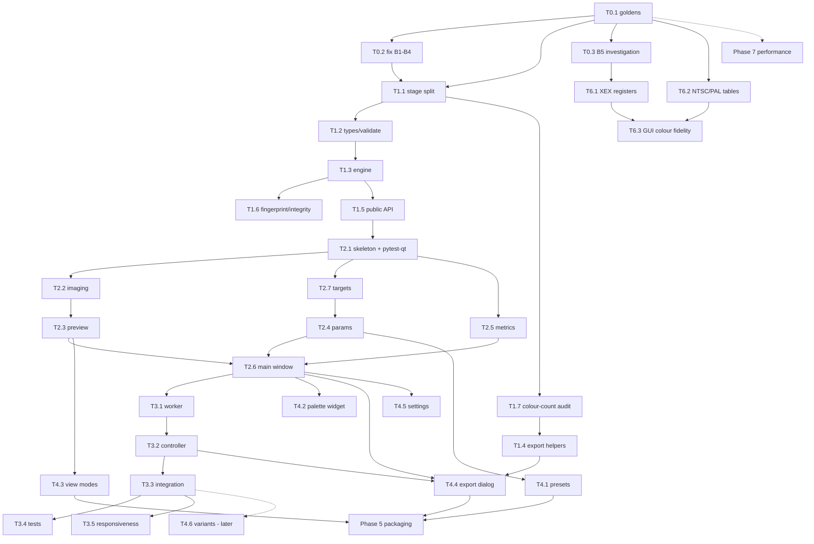

# PyImageConverter – PySide6 GUI Implementation Plan

> Status: **REVISION 6 – Phase 0 complete, Phase 1 in progress.** T1.1, T1.2, T1.3 (with the `73d3ec4`
> follow-up), T1.4 and T1.7 are accepted; **T1.5 and T1.6 are not started**. The checklist in §17 and the
> progress log in §20 are the authoritative status.
>
> Basis: direct inspection of `src/converter/**`, `src/tests/**`, `pyproject.toml`,
> `convert.py`, `.github/workflows/release-on-pr-close.yml`, plus a read-only timing /
> behaviour probe executed against the current code.
>
> Environment measured on the dev machine (2026-11-06): Python 3.14.3, NumPy 2.5.0,
> Pillow 12.2.0, PySide6 6.12.0 installed, `pytest-qt` **not yet** installed (added in T2.1),
> existing suite at the time of the analysis **30 passed** (558 after T1.4, see §20).
> The project floor stays Python 3.12 (no 3.13+ syntax).
>
> | Rev | Date | Content |
> |---|---|---|
> | 1 | 2026-08-07 | Analysis, defect report B1–B7, architecture proposal, tasks T0.1–T5.4, questions Q1–Q14 |
> | 2 | 2026-11-06 | Q1–Q14 answered by the user (see §16), extra requirements integrated (cache integrity, responsiveness measurement, stale-result rules), tasks added (T0.3, T1.6, T1.7, T2.7, T3.5, Phase 6), §17 checklist and §18 commit plan added |
> | 3 | 2026-11-06 | Phase 0 progress: T0.1 (`0b073cf`) and T0.2 (`cb47a36`) completed, B1–B4 fixed and verified, 59 tests green; T0.3 started. See §20 for the evidence |
> | 4 | 2026-11-06 | **Phase 0 complete** — T0.1 (`0b073cf`), T0.2 (`cb47a36`) and T0.3 (`f345c4a`) done and accepted. Phase 1 (T1.1) **not started**; it needs a separate go-ahead |
> | 5 | 2026-11-06 | T1.4 done (`09cde5b`): `check_export_compatibility`, public `normalize_antic_mode`, `export_result(..., antic_mode=...)`. Export architecture, verdict rules and the format-vs-product limit split documented in **§3.4.2**; §5.3 and §10 corrected to the implemented signature; evidence in §20.4 |
> | 6 | 2026-11-06 | Phase 1 status cleanup: T1.1 (`aa6fcd8`), T1.2 (`21ffdc3`) and T1.3 (`564d71b` + follow-up `73d3ec4`) marked done in §13/§17, the progress log gains §20.3, and the stale "Phase 1 not started" statements are removed. Documentation only |

---

## 1. Executive summary

The converter already has a usable seam for a GUI: `converter.pipeline.convert_image()` performs
the whole conversion **in memory** and returns a `ConversionResult` (indexed image, palette
indices, palette RGB, resized source, optional metrics). Export is a separate step
(`export_result()`). The CLI (`converter.main`) is a thin argparse layer on top.

Therefore the plan is **incremental**:

1. **Phase 0 – safety net:** freeze current CLI output with golden tests, then fix the four confirmed
   pipeline defects that would make GUI previews and metrics wrong (approved, Q1 — standalone commit
   after the baselines exist), and investigate the XEX colour-register question with emulator
   evidence (T0.3, no code change).
2. **Phase 1 – engine API:** split `convert_image()` into stage functions (bit-identical output)
   and add a new `ConversionEngine` with per-stage caching, frozen (immutable) cached arrays,
   source fingerprinting, cancellation checkpoints and timings.
   The CLI keeps calling `convert_image()`/`run_conversion()` unchanged.
3. **Phase 2–4 – GUI** in a separate package `src/converter_gui/` (PySide6 is an *optional*
   dependency; the CLI never imports Qt).
4. **Phase 5 – packaging** (optional extra `gui`, `gui-scripts` entry point, PyInstaller build).
5. **Phase 6 – colour fidelity** (real NTSC/PAL palettes, XEX register fix) and **Phase 7 –
   performance** are independent tracks that do not block the GUI.

The most important constraint discovered is **performance**: at 160×192 the error-diffusion
dithers take **0.4–4.2 s** (pure-Python per-pixel loops). Live preview will therefore be
"debounced + background + latest-wins + cached", not literally real-time for the slow
algorithms. Caching makes all non-dither parameter tweaks cheap and makes some changes
(e.g. quantizer while dithering is active, export-only settings) **free**.

---

## 2. Current architecture analysis

### 2.1 Repository layout (actual)

```text
py-image-converter/
├── convert.py                 # launcher: adds ./src to sys.path, calls converter.main.main()
├── pyproject.toml             # setuptools + setuptools-scm, packages found in src/, include converter*
├── src/
│   ├── converter/             # the package (NOT at repo root as the task template assumed)
│   │   ├── __init__.py        # only __version__
│   │   ├── __main__.py        # python -m converter
│   │   ├── main.py            # argparse CLI
│   │   ├── pipeline.py        # convert_image / export_result / run_conversion
│   │   ├── config.py          # load_config / save_config (JSON)
│   │   ├── types.py           # Enums, dataclasses (ConversionConfig, ConversionResult, …)
│   │   ├── image_loader.py, resize.py, sharpen.py, histogram.py, edge_detect.py
│   │   ├── palette.py, atari_palette.py, quantizer.py, dithering.py
│   │   ├── metrics.py, preview.py
│   │   ├── algorithms/        # 16 dither classes + base.py
│   │   └── exporters/         # png, bin, asm, dta, xex
│   └── tests/                 # pytest (testpaths = src/tests, pythonpath = src)
└── .github/workflows/release-on-pr-close.yml   # builds sdist/wheel on ubuntu, no tests run
```

### 2.2 Coding conventions observed (to follow)

- Module docstring on every file, `from __future__ import annotations`, full type hints.
- `str`-valued `Enum`s for algorithm choices; dict **registries** mapping enum → implementation.
- `@dataclass` for data (`ConversionConfig`, `ConversionResult`, `MetricResult`, …).
- NumPy arrays typed via aliases `RGBImage`, `IndexedImage`, `EdgeMask`.
- Ruff, line length 100, target py312. Tests are plain pytest functions using `tmp_path`.
- Package discovery: `[tool.setuptools.packages.find] where=["src"], include=["converter*"]`.

### 2.3 CLI (`converter/main.py`)

- `build_parser()` defines all options; `main(argv)` builds a `ConversionConfig`, optionally saves
  it, sets `label_name`, calls `run_conversion()`, and optionally writes an extra XEX (`-x`).
- Observations relevant to the GUI:
  - `--mode` is parsed but **never used** (`AtariMode` only has `ANTIC_E`).
  - `--antic-mode` is only honoured for the extra `-x/--xex` file
    ([main.py L175-182](../src/converter/main.py#L175-L182)); the XEX produced through
    `--export xex` (`export_result`) always auto-infers the mode.
  - With `--config`, all other CLI parameters except `--atari-colors` / `--label-name` are
    silently ignored.
  - `--save-config` is written **before** `label_name` is derived, so saved configs normally lack it.

### 2.4 Configuration (`config.py`, `types.ConversionConfig`)

- `ConversionConfig` is a flat dataclass mixing **conversion** parameters (width, height, resize,
  sharpen, sharpen_strength, palette, colors, background_index, dither, quantizer) and
  **output** parameters (preview, metrics, export_formats, atari_colors, label_name, mode).
- `to_dict()` / `from_dict()` give a stable JSON format (`export` key for formats, optional
  `atari_colors`, `label_name`). `load_config` / `save_config` are trivial JSON wrappers.
- **No validation**: bad enum strings raise `ValueError`, unknown keys are ignored, no ranges
  (e.g. `colors`, `background_index`) are checked, and there is no schema version.

### 2.5 Types (`types.py`)

| Type | Notes |
|---|---|
| `ResizeMethod` | nearest, bilinear, bicubic, lanczos |
| `DitherMethod` | 18 values (none, 7 error-diffusion, 3 Bayer, adaptive, 6 "atari_*" dither-lab) |
| `PaletteMethod` | popularity, kmeans, median_cut, octree, perceptual |
| `QuantizerMethod` | nearest, perceptual, weighted, adaptive |
| `ExportFormat` | png, bin, asm, dta, xex |
| `ConversionResult` | `indexed`, `palette_indices`, `palette_rgb`, `source_resized` (post-sharpen), `metrics` |
| `MetricResult` | mse, psnr, ssim (global, simplified), mean_rgb_error, mean_luminance_error, colors_used, histogram_coverage |
| `HistogramReport`, `AtariColor`, `ImageBuffer` | supporting types |

---

## 3. Existing pipeline analysis

### 3.1 Actual data flow of `convert_image()` ([pipeline.py L25-65](../src/converter/pipeline.py#L25-L65))



### 3.2 Stage dependency matrix (verified in code)

| Stage | Inputs (data) | Config fields | Cost @160×192 (measured) |
|---|---|---|---|
| Load | file path | – | 55 ms (256×192 PNG); grows with file size |
| Resize | source | width, height, resize | 8–16 ms (more for large sources) |
| Sharpen | resized | sharpen, sharpen_strength | 5 ms |
| Histogram | prepared | dither (only selects `full`) | 3 ms basic / **203 ms full** |
| Palette | prepared | palette, colors, background_index | median_cut 53, octree 61, perceptual 125, popularity **347**, kmeans **526** ms |
| Edges | prepared | – (sobel fixed) | 3 ms |
| Dither | prepared, palette_rgb, edges | dither | bayer/atari ordered 180–240, atkinson/diagonal/false-floyd 400–430, burkes/two-row-sierra ~600, sierra_lite 1.1 s, floyd 1.5 s, sierra 3.5 s, jarvis/stucki **4.1–4.2 s** |
| Quantize (dither=none only) | prepared, palette | quantizer | 4–7 ms |
| Metrics | prepared, indexed, palette | metrics | 12 ms |
| Export / previews | result | export_formats, atari_colors, label_name, preview, (antic mode) | ms |

Key facts:

- **All stages are deterministic** (k-means uses a fixed seed 42), so memoisation is valid.
- `quantizer` is **only used when `dither == none`**. With any dither active it has no effect.
- `edge_mask` depends only on the prepared image (not on palette or dither).
- `atari_colors`, `label_name`, `export_formats`, `preview`, `mode` never influence the
  indexed image, so they are **export-only** settings.
- The histogram report is used only for `local_variance`, which is computed only when
  `dither == ADAPTIVE`, but it is consumed only when `dither == NONE`. In practice the
  histogram stage is **dead work** (and `AdaptiveDither` computes its own variance map).
  **T0.2 fixes this (B4):** after the fix the variance map reaches the adaptive quantizer and is
  computed lazily only for `dither == none and quantizer == adaptive`.

### 3.3 Confirmed defects (verified by probe, not by README)

| ID | Defect | Location | Impact |
|---|---|---|---|
| **B1** | With `dither=none`, `quantize()` gets `list(range(N))`, i.e. Atari colours 0..3 (black, 64, 128, 192 grey), **not** the selected palette | [pipeline.py L45-51](../src/converter/pipeline.py#L45-L51) | Wrong pixel assignment for `--dither none` (probe: result ≠ correct-palette quantization) |
| **B2** | Metrics computed against `range(N)` instead of `palette_indices` | [pipeline.py L55-57](../src/converter/pipeline.py#L55-L57) | Metrics are wrong (probe: MSE 11760 vs 1444 with the real palette). `baselines.json` encodes the wrong values |
| **B3** | Preview images (x2, x4, compare, heatmap) use `range(N)` | [pipeline.py L114-124](../src/converter/pipeline.py#L114-L124) | `--preview` files show grey 0..3 instead of real colours |
| **B4** | `QuantizerMethod.ADAPTIVE` never receives a variance map (see 3.2), so it always behaves like `nearest` | pipeline.py L33/L50 | The option does nothing different |
| **B5** | XEX init writes `palette[0..4]` to `$02C4..$02C8` (COLOR0..COLOR4). In ANTIC E, pixel value 0 is COLBK = `$02C8`. Background colour lands in PF0, so colours look shifted by one on hardware. ASM comment says "COLBK, COLPF0-PF3" (different order) | [xex_export.py L191-228](../src/converter/exporters/xex_export.py#L191-L228), [asm_export.py L35-43](../src/converter/exporters/asm_export.py#L35-L43) | Needs verification in an emulator — **approved for investigation, T0.3**; code change only after evidence (T6.1) |
| **B6** | `atari_palette._ATARI_RGB` is **not** the real GTIA palette (index ≠ hue·16+lum in RGB terms; e.g. index 101 = grey 160, while hardware `$65` is a purple-blue). Indices are written to colour registers as-is | atari_palette.py | On-screen preview colours ≠ colours on real hardware / emulator |
| B7 | `nearest_atari_index` computes an unused `dist` per colour; popularity uses an N×256×3 float tensor | atari_palette.py L333-352 | Performance only |

B1–B4 directly affect what a GUI would display (preview, metrics, heatmap).

**Decided (see §16):**

- **B1–B4** — **FIXED and verified** (Phase 0). Baselines were captured first in T0.1 (`0b073cf`),
  then the defects were fixed in the standalone commit `cb47a36` (no refactoring). Before/after
  evidence and the regenerated fixtures are recorded in §20.
- **B5** is investigated separately (**T0.3**): emulator evidence first, code change only afterwards
  (T6.1). No change without proof.
- **B6 / B7** are deferred to **Phase 6 (colour fidelity)** and **Phase 7 (optional performance)**
  respectively; both are decoupled from the GUI work.

### 3.4 Export layer

| Exporter | Signature | Constraints |
|---|---|---|
| `export_png(indexed, palette_rgb, path)` | indexed PNG with palette | any size; ≤256 colours |
| `export_bin(indexed, path)` | `pack_antic_e` raw 7680 B | **160×190 or 160×192, values 0-3** |
| `export_asm(indexed, path, label, load_address=0x6000, atari_colors)` | ca65 `.byte` | same as BIN; `_COLORS` table only if `atari_colors` |
| `export_dta(indexed, path, load_address=0x6000)` | `.byte` listing | same as BIN |
| `export_xex(indexed, path, palette_indices, antic_mode, atari_colors)` | runnable viewer | D (2bpp, `width % 4 == 0`; inferred for 160×96), E (2bpp, `width % 4 == 0`), F (1bpp, values 0-1, `width % 8 == 0`; 320 only for inference) |

`export_result(result, output_path, config, *, antic_mode=None)` loops over `config.export_formats`,
derives file names from the output stem (`.bin/.png/.s/.dta/.xex`), writes previews if
`config.preview`, and forwards the **keyword-only** `antic_mode` to `export_xex` only — every other
exporter ignores it and `None` keeps the shape-based inference, so the default call path stays
byte-identical (proved by the CLI goldens, §3.4.2). `check_export_compatibility` answers "would this
export succeed?" before anything is written.

#### 3.4.1 Colour-count audit findings (T1.7)

Verified by `src/tests/test_colour_counts.py` (326 cases, ≈4 s): every palette selector, every
quantizer and all 17 dithering algorithms behave correctly for `N ∈ {2, 3, 4, 8, 16}` — palettes hold
exactly N unique indices, indexed pixels always stay inside `0..N-1`, metrics and the error heatmap
work, and the results are deterministic.

**Declared vs actually used colours.** `colors=N` guarantees a palette of N unique indices, but an
algorithm may use fewer. `adaptive` picks a dither per 16×16 tile, so on the audit fixture it never
leaves indices 0–3 at N=8, while at N=16 it reaches index 15 but only for a small part of the image
(175 of 3072 pixels). The tests therefore assert `colors_used <= N`, never `== N`, and a separate
regression test proves that every dithering algorithm (including `adaptive` at N=16) really uses
indices ≥ 4.

**Verified exporter limits** (each row is exercised by a test that runs the real exporter):

| Format | Colours | Shape | Error when violated |
|---|---|---|---|
| **PNG** | ≤ **256** (technical maximum) | any | `ValueError` from NumPy when the palette exceeds 256 entries (unreachable through the pipeline, which caps at 256) |
| **BIN / ASM / DTA** | ≤ 4 (`MAX_ATARI_COLORS`) | 160×190 or 160×192 | `Indexed values must be 0-3 for 2bpp mode` / `ANTIC E requires 160x190 or 160x192, got …` |
| **XEX D / E** | ≤ 4 | `width % 4 == 0` | `Indexed values must be 0-3 for 2bpp mode` |
| **XEX F** | ≤ 2 | `width % 8 == 0` | `Indexed values must be 0-1 for ANTIC F (1bpp)` |
| **XEX, no inferable mode** | – | 160×96 → D, 160 wide → E, 320 wide → F | `Cannot infer ANTIC mode from image shape …` |
| **XEX, unknown mode** | – | – | `Invalid ANTIC mode. Use one of: D, E, F, 7, 15, 8` |

Corrections to the table above: an **explicit** mode F does not require a 320-wide image — 320 is
only what the *inference* maps to F; with `antic_mode="F"` any width divisible by 8 packs fine, and
an explicit D/E likewise accepts shapes other than the usual 96/192 lines because it falls back to
`_pack_2bpp`.

**Known gaps, documented but deliberately not fixed by T1.7:**

- XEX widths that do not fit the packing unit (D/E: `% 4`, F: `% 8`) raise a bare **`IndexError`**
  (`index N is out of bounds`) instead of a validated `ValueError`; see T1.4 (export helpers).
- PNG with more than 256 palette entries fails inside NumPy (`could not broadcast … (771,) into
  (768,)`); the pipeline never produces such a palette because `_fill_palette` caps at 256.
- `colors > 256` is silently reduced to 256 entries by `_fill_palette` (the pipeline does not call
  `validate_config`).
- `colors = 1` renders a single-colour image; `validate_config` keeps the GUI at 2..256.

**`MAX_PNG_COLORS = 16` is a product cap, not a format limit.** PNG supports 256 colours; 16 is
chosen for interactive speed (at 160×192 the palette stage grows with N: k-means 49 ms at N=2 →
319 ms at N=16 → 4.4 s at N=256). The constant is defined in the GUI package
(`converter_gui/limits.py`) in T2.4 and deliberately **not** in the converter core, so the CLI and the
exporters keep the full PNG capability.

#### 3.4.2 Export compatibility helper and `antic_mode` passthrough (T1.4)

Three additions, all backward compatible (implemented in `09cde5b`):

| API | Location | Behaviour |
|---|---|---|
| `check_export_compatibility(result, fmt, *, antic_mode=None) -> str \| None` | `exporters/compat.py` (new), re-exported from `converter.exporters` | `None` = the export will succeed; a string = a readable reason phrased like the exporter's own validation (the mode errors are its `ValueError` text verbatim). Writes nothing, calls no exporter |
| `normalize_antic_mode(antic_mode, indexed) -> str` | `exporters/xex_export.py` (was private `_normalize_antic_mode`) | the single implementation of the mode rules: explicit `D`/`E`/`F`, the BASIC aliases `7`/`15`/`8`, case-insensitive; `None` infers D (160×96), E (160 wide), F (320 wide); raises `ValueError` for an unknown mode or an uninferable shape |
| `export_result(result, output_path, config, *, antic_mode=None)` | `pipeline.py` | keyword-only, forwarded to `export_xex` **only**; PNG/BIN/ASM/DTA ignore it; `None` reproduces the previous output byte for byte |

`export_xex` and the helper share the one public `normalize_antic_mode`, so the mode rules and their
error messages cannot drift and no private name is imported across modules.

**Verdicts are computed from the real result, not from the requested configuration.** The helper reads
`result.indexed.shape` and the index values that actually occur (`indexed.max()`), plus the real number
of palette entries — never `config.colors`. This is required because `colors=N` only guarantees a
palette of N distinct indices: `adaptive` at N=8 may never leave indices 0–3 (§3.4.1), so a
config-based check would grey out BIN for an image that `pack_antic_e` accepts instantly.

Per-format rule table (kept in sync with §3.4.1 by the tests, not by hand):

| `fmt` | Helper checks | Reused source of truth |
|---|---|---|
| `PNG` | palette entries ≤ 256 | `_PNG_MAX_COLORS` = size of a PNG palette chunk |
| `BIN` / `ASM` / `DTA` | `ANTIC_E_WIDTH` × 190 or 192, then indices ≤ 3 | `ANTIC_E_WIDTH`/`ANTIC_E_HEIGHT` from `atari_bin_export`, `MAX_ATARI_COLORS` |
| `XEX` | mode resolution, then indices ≤ 3 (D/E) or ≤ 2 (F), then the packing width | `normalize_antic_mode` + the same 2bpp/1bpp bit |

**Invalid XEX widths.** D/E pack 4 pixels per byte, F packs 8 (`pixels_per_byte = 8 // bits` — derived
from the same bpp bit, not restated per mode). For a width that is not a multiple of the unit the
helper returns e.g. *"mode D requires a width divisible by 4 (got 158); export_xex would fail with
IndexError"*, so the GUI can disable the format instead of crashing. The bare **`IndexError`** raised
inside `pack_2bpp`/`pack_1bpp` for those widths is **deliberately not fixed** here (known gap, §3.4.1):
changing exporter exception types is a separate behaviour decision; T1.4 documents it and predicts it,
it does not mask it. The test matrix therefore accepts `ValueError` *and* `IndexError` as "the export
really fails".

A `ValueError` from `normalize_antic_mode` (unknown mode, uninferable shape) is caught and returned as
the reason, so callers have exactly one failure channel: a string. Nothing else from `compat.py` leaks
exporter internals.

**Equivalence is proven, not assumed.** A 33-case matrix in `src/tests/test_exports.py`
(`shape × max occurring index × palette size × format × antic_mode`) runs the *real* exporter for every
verdict and asserts `helper is None` ⇔ the export succeeds, and a message ⇔ it raises. Further tests
pin the message contents, the alias/inference behaviour of `normalize_antic_mode`, and — for
`export_result` — that the default path is byte-identical, that `antic_mode` reaches `export_xex`, that
the other formats ignore it, and that an invalid mode propagates.

**Technical format limits vs GUI product limits.** Everything the helper reports is a **technical**
limit of the format or of the current exporter: PNG 256 colours, 2bpp playfields 4, 1bpp 2, ANTIC E
160×190/192, XEX widths matched to the packing unit. It says nothing about product policy: the GUI caps
colours at `MAX_PNG_COLORS = 16` (interactive speed, §3.4.1) and offers 2–4 elsewhere, and it lives in
`converter_gui/limits.py`, not in the core. A GUI-side policy may therefore be *stricter* than the
verdict without the core ever rejecting a value the CLI accepts today.

### 3.5 Preview & metrics reuse

- `preview.error_heatmap(original, converted)`, `upscale_nearest`, `side_by_side`: pure
  NumPy and directly reusable (the GUI will mostly use Qt scaling instead of `upscale_nearest`).
- `metrics.compute_metrics(original, indexed, palette_indices)`: cheap (12 ms). The GUI should
  always compute it.
- `metrics.format_metrics()`: CLI text, reusable for a "copy metrics" action.

### 3.6 Tests (existing, 30 passing)

| File | Covers |
|---|---|
| test_integration.py | `convert_image` + `export_result` (BIN/PNG), BIN round-trip |
| test_regression.py | Floyd metrics vs `fixtures/baselines.json` (tolerance MSE ±50, SSIM ±0.05). **Locks in B2** |
| test_config.py | partial round-trip (no atari_colors/label_name) |
| test_exports.py | ASM/DTA/XEX structure, D/E/E190/F display lists |
| test_dithering/floyd/adaptive | shape/range only, no golden outputs |
| test_palette, test_quantizer_palette, test_resize, test_image_loader, test_bin_export, test_metrics_preview | unit level |

Gaps: **no CLI (`main()`) tests at all**, no golden image outputs for dithers, no tests of
`--atari-colors`, `--label-name`, `-x`, `--config`/`--save-config`, `--preview`.

---

## 4. Proposed architecture



Principles:

- **One processing implementation.** `convert_image()` and `ConversionEngine.convert()` call the
  same stage functions. No algorithm is reimplemented in the GUI.
- **Dependency direction:** `converter_gui → converter`, never the reverse. The CLI and core
  never import PySide6. PySide6 is an optional extra.
- **Engine is Qt-agnostic.** It is used from a worker thread, owns its cache, and is never
  touched by the GUI thread.

### 4.1 Package location: evaluated against the task template

The template's top-level `gui/` package does **not** fit:

- The project uses a `src/` layout. Packaging only includes `converter*`.
- `gui` is a generic top-level name with a high collision risk once installed into site-packages.

**Recommendation:** `src/converter_gui/` (installed as package `converter_gui`), plus
`include = ["converter*"]`, which already matches `converter_gui*`. Tests go in
`src/tests/gui/`. A root launcher `convert_gui.py` mirrors `convert.py`.
**Decided (Q4):** `src/converter_gui/` — approved as proposed.

```text
src/converter_gui/
├── __init__.py
├── __main__.py                  # python -m converter_gui
├── app.py                       # main(): QApplication, org/app names, MainWindow
├── main_window.py
├── imaging.py                   # numpy <-> QImage/QPixmap helpers
├── presets.py                   # built-in presets + user preset storage
├── settings.py                  # QSettings wrapper (typed accessors)
├── widgets/
│   ├── image_preview.py         # QGraphicsView based zoomable view + split view
│   ├── parameter_panel.py
│   ├── palette_widget.py
│   └── metrics_panel.py
├── dialogs/
│   └── export_dialog.py         # (open-image uses QFileDialog directly – no own module needed)
├── workers/
│   └── conversion_worker.py
└── controllers/
    └── conversion_controller.py
```

`dialogs/open_image.py` from the template is unnecessary: `QFileDialog.getOpenFileName` with
the filter derived from `image_loader.SUPPORTED_EXTENSIONS` is enough.

---

## 5. Recommended public conversion API

Reuse the existing `ConversionConfig` (renaming it to `ConverterConfig` would break the CLI, the
JSON format and tests for no gain).

```python
from converter import ConversionConfig, ConversionEngine
from converter.types import DitherMethod, PaletteMethod

engine = ConversionEngine()                 # holds per-stage cache
engine.set_source("input.png")              # or engine.set_source_array(rgb_ndarray)

config = ConversionConfig(palette=PaletteMethod.KMEANS, dither=DitherMethod.ATKINSON,
                          sharpen=True, sharpen_strength=1.2)
result = engine.convert(config, compute_metrics=True, cancel=lambda: False)

result.indexed          # H×W uint8, 0..N-1
result.palette_indices  # Atari indices
result.palette_rgb      # N×3
result.converted_rgb    # NEW property: palette_rgb[indexed]
result.source_resized
result.metrics          # MetricResult | None
result.timings          # NEW: always {"prepare", "palette", "edges", "render", "metrics"};
                        # 0.0 means the stage did no work (cache hit or intentionally skipped)
```

### 5.1 Stage functions (refactor of `pipeline.py`, behaviour-preserving)

```python
def prepare_image(image: RGBImage, config: ConversionConfig) -> RGBImage: ...   # resize + sharpen
def choose_palette(image: RGBImage, config: ConversionConfig) -> list[int]: ...
def compute_edges(image: RGBImage) -> EdgeMask: ...
def render_indexed(image: RGBImage, palette_indices: list[int], edge_mask: EdgeMask,
                   config: ConversionConfig) -> IndexedImage: ...
def build_metrics(image: RGBImage, indexed: IndexedImage,
                  palette_indices: list[int]) -> MetricResult: ...

def convert_image(input_path, config) -> ConversionResult:   # unchanged signature & output
    source = load_image(input_path).data
    prepared = prepare_image(source, config)
    ...
```

### 5.2 Engine

```python
class ConversionCancelled(Exception): ...

@dataclass(frozen=True)
class SourceIdentity:
    """Immutable identity of the loaded source image (cache key for L0)."""
    path: str | None          # None for set_source_array
    size: int | None          # bytes on disk
    mtime_ns: int | None
    sha256: str | None        # only when verify_content=True or explicitly requested
    array_token: int | None   # id()-based token for set_source_array


class ConversionEngine:
    def __init__(self, max_results: int = 32) -> None: ...
    def set_source(self, path: str | Path, *, verify_content: bool = False) -> None
    def set_source_array(self, image: RGBImage) -> None       # copies + freezes the input
    @property
    def source(self) -> RGBImage | None                       # read-only view
    @property
    def source_identity(self) -> SourceIdentity | None        # for GUI reload checks
    def source_is_unchanged(self, *, verify_content: bool = False) -> bool
    def convert(self, config: ConversionConfig, *, compute_metrics: bool | None = None,
                cancel: Callable[[], bool] | None = None) -> ConversionResult
    def clear_cache(self) -> None
```

- `max_results` caps the **L3 (indexed)** and **L4 (metrics)** caches (default 32); L1 (prepared image +
  edge mask) and L2 (palette) use the fixed capacities from §8 (4 and 8).
- `cancel()` is checked **between stages**. Cancelling inside a dither loop would require
  touching all 16 algorithm classes, which is deferred (see 7.4).
- `compute_metrics=None` means "use `config.metrics`" (CLI semantics). The GUI passes `True`.
- **`timings` contract:** every result carries exactly five keys — `prepare`, `palette`, `edges`,
  `render`, `metrics` — always present and always in that order. The value is the wall-clock
  seconds the stage actually ran; **`0.0` means no work was performed**, i.e. the stage was served
  from cache *or* intentionally skipped (metrics disabled). The palette stage covers both
  `choose_palette` and `palette_rgb`, while cache bookkeeping (freezing, insertion) is never
  counted. The two cases are told apart by `result.metrics`: `None` ⇒ metrics were skipped, a
  `MetricResult` with `timings["metrics"] == 0.0` ⇒ cached.
- **Cache integrity (mandatory):** every array stored in a cache level is held as a **read-only view
  over an immutable `bytes` buffer** (`np.frombuffer(array.tobytes(), dtype=…).reshape(shape)`), and
  the engine returns those same arrays. A plain `setflags(write=False)` is **not** sufficient: NumPy
  lets a caller flip it back with `setflags(write=True)` and mutate the buffer. With the bytes-backed
  form the assignment, the flag flip *and* the `.base` escalation all raise `ValueError`, instead of
  silently corrupting a later conversion. Callers needing to modify data must `.copy()`. See §8.1.
- **Source invalidation:** the L0 key is the `SourceIdentity`. By default it is the cheap
  `(resolved path, size, mtime_ns)` triple. `verify_content=True` adds a SHA-256 digest of the
  file bytes (`hashlib.file_digest`, stdlib, Python ≥ 3.11), which detects a rewrite that keeps
  the same size and the same mtime granularity, and — conversely — treats a bare `touch` as
  "unchanged" (hash equal ⇒ cache hit). The GUI uses `verify_content=True` for
  *File ▸ Reload* and on window re-activation, never in the interactive conversion path.
- The engine is pure Python + NumPy: no Qt import, no open file handles, no global mutable state,
  so it also remains usable from a future process-based backend (§7.3).
- **Concurrency:** an instance is **not thread-safe** and is meant for a **single worker thread**
  (T3.1 owns it inside the conversion worker; the GUI thread never calls it directly). No locks and
  no global state; separate instances have independent caches.

### 5.3 Supporting additions

- `config.validate_config(config) -> list[str]`: range and enum sanity (colors 2–4, sizes > 0,
  background 0–255, sharpen_strength ≥ 0). Used by GUI and preset loading. The CLI behaviour stays unchanged.
- `exporters.compat.check_export_compatibility(result: ConversionResult, fmt: ExportFormat, *,
  antic_mode: str | None = None) -> str | None` — implemented in T1.4, detailed in §3.4.2. It mirrors
  the existing exporter checks so the GUI can disable formats before writing. It **calls** the same
  constants (`ANTIC_E_WIDTH`, `MAX_ATARI_COLORS`, …) and the now-public `normalize_antic_mode()` rather
  than duplicating logic, and it reads the real `ConversionResult` (shape plus the indices that actually
  occur) instead of the requested `colors`. The per-colour-count limits it reports are confirmed by the
  T1.7 audit (Q7), not guessed.
- `export_result(..., *, antic_mode: str | None = None)`: passed through to `export_xex` only.
  Default `None` gives the current behaviour.
- `converter/__init__.py` re-exports `ConversionConfig`, `ConversionResult`, `ConversionEngine`,
  `convert_image` (lazy import not needed: NumPy is already a hard dependency).
- Constant `MAX_ATARI_COLORS = 4` (2bpp playfield limit) exported from `converter.types` and used by
  `validate_config`, the export compatibility helper and the GUI. Values above 4 are legal for
  PNG-only output (§6.2, T1.7) and are not rejected by the core.

---

## 6. GUI layout and components

```text
┌──────────────────────────────────────────────────────────────────────────────┐
│ File  Edit  View  Presets  Help                                              │
├──────────────────────────────────────────────────────────────────────────────┤
│ [Open] [Export] | Preset: [Best Quality ▾][Save…] | View: [Side|Split|Heat|Orig]
│ Zoom: [1x 2x 4x 8x Fit] [☐ Atari pixel aspect] [☑ Auto-update] [Convert]     │
├───────────────────────────────────────────────┬──────────────────────────────┤
│                                               │ ▸ Output (target, size)      │
│   Original (resized)    │    Atari result     │ ▸ Resize / Sharpen           │
│   (synchronised zoom/pan between both views)  │ ▸ Palette                    │
│                                               │ ▸ Dithering / Quantization   │
│   overlay: "Updating…" / "Stale" / error      │ ▸ Atari colours (export)     │
│                                               ├──────────────────────────────┤
│                                               │ Palette: ■ ■ ■ ■  $00 $65 …  │
│                                               │ Metrics: PSNR / SSIM / MSE … │
├───────────────────────────────────────────────┴──────────────────────────────┤
│ status: lena.png 256×192 → 160×192 | palette 347 ms, dither 1460 ms | ready  │
└──────────────────────────────────────────────────────────────────────────────┘
```

### 6.1 Central image preview (`widgets/image_preview.py`)

- `QGraphicsView` + `QGraphicsPixmapItem`. `setTransformationMode(Qt.FastTransformation)` and
  disabled smooth render hints give nearest-neighbour scaling. Zoom is applied via view transform:
  presets 1/2/4/8, Ctrl+wheel, and **Fit** (`fitInView`, rounded down to an integer factor
  when "pixel-perfect" is on).
- **Side-by-side:** two views with synchronised transform and scrollbars (shared zoom model).
- **Split view:** one scene with both pixmaps; a draggable vertical divider clips the converted
  item (`QGraphicsItem` clip or custom `paint`).
- **Heatmap:** `preview.error_heatmap(result.source_resized, result.converted_rgb)`.
- **Original:** full-resolution loaded source (from engine) for reference.
- **Atari pixel aspect** toggle: horizontal ×2 for 160-wide modes (ANTIC D/E pixels are double
  width on hardware). Display-only, never affects conversion output.
  **Decided (Q13): ON by default** whenever the target is 160-wide, disabled (and greyed out, with a
  tooltip) for 320-wide targets (ANTIC F, 1:1 pixels). The choice is user-toggleable in *View* and
  persisted in `QSettings`, per target width.
- `imaging.ndarray_to_qimage()` must ensure a C-contiguous array, pass `bytesPerLine`, and keep a
  reference / `.copy()` the QImage (avoid dangling buffers).

### 6.2 Parameter panel (`widgets/parameter_panel.py`) – only engine-supported parameters

| Group | Field | Widget | Range / values | Recomputes from |
|---|---|---|---|---|
| Output | target | QComboBox | "ANTIC E 160×192 (4 col)", "ANTIC E 160×190 (4 col)", "ANTIC D 160×96 (4 col)", "ANTIC F 320×192 (2 col)", "Custom" (Q6, module `targets.py`, T2.7) | resize |
| Output | width / height | QSpinBox | 8–640 / 8–480, enabled for Custom | resize |
| Resize | resize | QComboBox | `ResizeMethod` | resize |
| Sharpen | sharpen | QCheckBox | – | sharpen |
| Sharpen | sharpen_strength | QDoubleSpinBox | 0.0–5.0, step 0.1, enabled when sharpen | sharpen |
| Palette | palette | QComboBox | `PaletteMethod` | palette |
| Palette | colors | QSpinBox | 2–4; extended to 2–16 **only** while every selected export format is PNG (Q7, T1.7) | palette |
| Palette | background_index | QSpinBox + swatch | 0–255 | palette |
| Dithering | dither | QComboBox (grouped, speed hint) | `DitherMethod` | dither |
| Quantization | quantizer | QComboBox | `QuantizerMethod`; **enabled only when dither = none** (otherwise ignored by engine) | dither |
| Atari colours | atari_colors | 5× hex QSpinBox + "use converter palette" | **export-only**, no recompute, visibly labelled as hardware registers (Q14) | – |

Decisions baked into this panel:

- **Q6 (targets):** the target combo writes `width`/`height` (and for ANTIC F caps `colors` at 2);
  editing width/height by hand switches the combo to "Custom". The target also selects the default
  XEX mode for the Export dialog. `ConversionConfig.mode` stays untouched (`AtariMode` only has
  `ANTIC_E`, and `--mode` is unused by the CLI) — the target is explicit GUI state plus
  width/height, not a new hidden config field, so presets stay CLI-compatible.
- **Q7 (colour count):** 2–4 is the default range. More colours are allowed only when the export
  selection is PNG-only, and only after the T1.7 audit proves the pipeline (all 18 dithers,
  4 quantizers, 5 palette selectors, metrics, heatmap) is correct for N > 4. The cap is 16 because
  `PopularitySelector`/`OctreeSelector` and the dither inner loops are pure Python and get slow.
- **Q14 (two palettes):** the panel's `atari_colors` group is titled
  "Hardware colour registers (export only)" and shows a hint that it does **not** change the preview.

Not exposed: `mode` (only ANTIC_E exists), edge-detection method/threshold (hard-coded),
k-means seed and Bayer amplitude (internal constants). `preview`, `export_formats` and `label_name`
live in the Export dialog. `metrics` is always on in the GUI and is **not** written back to the saved config.

Panel API: `set_config(cfg)` (blocks signals while populating), `config() -> ConversionConfig`,
signal `config_changed(ConversionConfig)`. Enum combos are generated from the enums, so new
algorithms appear automatically.

### 6.3 Palette widget (`widgets/palette_widget.py`) – two distinct colour concepts (Q14)

The widget always shows **two clearly separated rows**, because the converter's RGB table and the
Atari hardware colour registers are different things:

| Row | Title | Source | Editable | Affects |
|---|---|---|---|---|
| 1 | "Converter palette (what you see)" | `result.palette_indices` + `palette_rgb` | no | preview, metrics, indexed output |
| 2 | "Hardware colour registers (export only)" | `config.atari_colors`, or `—` when unset | via the parameter panel | ASM `_COLORS` table and XEX init code only |

Row 1 shows a swatch per entry with the Atari index in hex (`$65`), `AtariColor.name`, a background
marker and a tooltip (RGB, luminance, index). Row 2 is greyed out with the note
"does not change the on-screen preview" and a link to the colour-fidelity work (Phase 6), because
`_ATARI_RGB` is still an approximation (B6) and the XEX register order is unverified (B5).

Editing the palette itself is **future work**: it needs a new `palette_override: list[int] | None`
config field so the palette stage is skipped (cache-friendly). Phase 6 adds the editing UI together
with real palettes.

### 6.4 Metrics panel (`widgets/metrics_panel.py`)

Read-only form for the 7 `MetricResult` fields plus per-stage timings. "Copy" uses `format_metrics`.

---

## 7. Background processing design

### 7.1 Components



- **Worker:** one `QObject` moved to one dedicated `QThread` (a single engine means a single cache
  and no contention). Slots run in the worker thread. Results travel as `Signal(int, object)`
  through queued connections. This concrete implementation is `QThreadBackend`, the v1
  implementation of the `ConversionBackend` protocol (§7.3); the controller depends only on the
  protocol.
- **Generation IDs:** every config or source change increments `latest_gen` (a Python int; reads
  are atomic under the GIL). Results whose generation is not the latest are discarded. This
  guarantees that **older results never overwrite newer ones**.
- **Coalescing:** at most one running job and one pending job; the pending slot is overwritten.
- **Cancellation:** cooperative, between stages, via the `cancel` callable. A stale job stops at the
  next stage boundary (for example, it skips dithering if the palette finished after a new request).
- **Debounce:** 300 ms single-shot `QTimer`, restarted on each change. Combos and checkboxes can
  use a shorter delay (e.g. 50 ms), and spinboxes the full delay.
- **Auto-update toggle + Convert button** for users who choose slow dithers (Jarvis/Stucki ~4 s).
- **Errors:** worker catches all exceptions. The controller emits `conversion_failed(msg)`. The UI
  keeps the last good image, shows a non-modal error banner and logs the traceback (exact rules in
  §7.6).
- **Busy UX:** overlay "Updating…" after 150 ms, plus a "stale" badge when the displayed image does
  not match the current parameters.
- **Image loading** also runs in the worker (`set_source`) with its own generation.
- **Shutdown:** `closeEvent` bumps the generation (which cancels work), calls `thread.quit()` and
  `thread.wait(timeout)`. A running dither stage cannot be interrupted, so the wait may last
  up to one stage (acceptable; documented).

### 7.2 GIL contention: measured acceptance criteria (Q5)

Dither loops are pure Python and hold the GIL, but CPython switches threads every 5 ms
(`sys.getswitchinterval()` default), so the Qt event loop keeps running. The expected effect is
slight stutter, **not** a freeze — but this must be *measured*, not assumed (T3.5).

Acceptance for the worst case (160×192 source, `jarvis`/`stucki` ≈ 4.1–4.2 s on the worker thread,
measured on the dev machine):

| Metric | Threshold |
|---|---|
| Longest main-thread event-loop gap | **< 100 ms** |
| 95th-percentile gap | **< 50 ms** |
| Input latency (spinbox drag → value applied) | < 50 ms |
| Window drag / repaint during a dither | visibly smooth, no "not responding" OS state |

Measurement: a 16 ms `QTimer` heartbeat in the GUI thread records `elapsed()` deltas while the
worker runs each of `jarvis`, `stucki`, `floyd`, `none`; results go to `docs/GUI_PERFORMANCE.md`
(created in T3.5) and the test is marked `slow` so it does not run by default.

If the threshold is missed, the escalation order is fixed in advance:
1. `sys.setswitchinterval(0.001)` in the GUI process (one line, no behaviour change);
2. optional fine-grained `cancel` checks inside the dither loops (§7.4);
3. the process-based backend (§7.3) — still future work, needs its own decision.

### 7.3 Future alternative, not part of v1: process-based backend (Q5)

**Decided:** v1 uses **QThread + cooperative cancellation**. A process-based backend stays a
documented option only.

`concurrent.futures.ProcessPoolExecutor` (stdlib) would allow hard cancellation (terminate) and no
GIL contention. Downsides: the cache must live in the child process, pickling and start-up costs,
`multiprocessing.freeze_support()` and PyInstaller complications.

To keep that door open without paying for it now, the GUI isolates the backend behind one seam:

```python
class ConversionBackend(Protocol):                       # converter_gui/workers/base.py
    def load_source(self, gen: int, path: str) -> None: ...
    def convert(self, gen: int, config: ConversionConfig) -> None: ...
    def cancel(self, gen: int) -> None: ...
    def shutdown(self, timeout_ms: int) -> None: ...
    # signals: source_loaded(int), finished(int, object), failed(int, str), cancelled(int)
```

`QThreadBackend` implements it in v1; the controller only talks to the protocol, so the process
backend can be added later without touching the controller or the views. The protocol is a plain
`typing.Protocol` with no Qt in its signature (only the implementation imports Qt).

### 7.4 Deferred: fine-grained cancellation

An optional `cancel` check every N rows inside `DitherAlgorithm.apply` would require changing the
base interface and 16 classes. Defer it; consider it together with the optional performance phase.

### 7.5 Displayed result vs requested configuration (mandatory rules)

Two pieces of state are kept **separately** and never merged:

```python
@dataclass(frozen=True)
class DisplayedConversion:          # immutable tuple: result and the config that produced it
    generation: int
    config: ConversionConfig        # deep copy of the config used for this result
    result: ConversionResult
    timings: dict[str, float]
    produced_at: float

# controller state
requested_config: ConversionConfig      # latest UI state
latest_generation: int                  # bumped on every change
displayed: DisplayedConversion | None   # what the views show (last SUCCESSFUL conversion)
running_generation: int | None
last_error: str | None
```

Derived flags, used by the UI:

- `is_updating = running_generation is not None`
- `is_stale = displayed is None or displayed.generation != latest_generation`
  (generation comparison is enough because every config/source change bumps it; the config copy
  exists for display and for the export call, not for equality checks)

Rules (each has a test in T3.4 / T4.4):

1. The status bar distinguishes **"updating… (gen N)"**, **"stale – showing gen M"** and
   **"ready (gen N)"**; a corner badge shows the same state, so the user can never mistake an old
   image for the current parameters.
2. **Export is only ever enabled when `not is_stale`.** The Export action is disabled (with a
   tooltip "conversion up to date" requirement) while a job is running and while the displayed
   generation is behind. If the user presses Export while stale (e.g. via a shortcut), the
   controller queues **one** export intent, and the dialog opens after the fresh result arrives.
3. The export path receives the `DisplayedConversion`, not a bare result, so the config that
   produced the image is always the config used for exporting (no accidental mismatch).
4. `is_stale` must use the generation, not a config-equality heuristic: two configs can produce
   identical cache keys (e.g. export-only changes), in which case the flag simply stays false
   because no new job was needed — the display is *not* stale then.
5. Timings and metrics shown belong to the displayed conversion, never to a newer pending one.

### 7.6 Failure handling: keep the last good preview

- On `failed(gen, message)`: `displayed` is **left untouched**, `last_error` is set, the error banner
  appears (non-modal, dismissible, with "Show details" for the traceback) and the status bar shows
  "error – still showing gen M".
- On `cancelled(gen)`: no UI error; if the cancellation came from a newer request, the newer job is
  already pending.
- The metrics panel keeps the last good metrics but adds an "outdated (gen M)" marker, so stale
  numbers are never presented as current.
- An error never clears the image, never clears the palette widget, and never disables Export for
  the still-displayed (non-stale) result. If the displayed result *is* stale after a failure,
  Export stays disabled — the last good image is preserved, but it is not exportable as if it were
  current.
- Only the worker logs full tracebacks (`logging`), the UI shows a one-line summary plus details.

---

## 8. Caching strategy

Based on the verified dependency matrix (3.2):

| Cache level | Key | Value | Invalidated by |
|---|---|---|---|
| L0 source | `SourceIdentity` = resolved path + size + `mtime_ns` (+ `sha256` when `verify_content=True`), or the array token for `set_source_array` | full-res RGB (frozen, read-only) | `set_source`, `verify_content` mismatch |
| L1 prepared | (width, height, resize, sharpen, round(sharpen_strength, 6) if sharpen else None) | prepared RGB + edge mask (both frozen) | size/resize/sharpen |
| L2 palette | L1 key + (palette, colors, background_index) | indices, palette_rgb (frozen) | + palette params |
| L3 indexed | L2 key + (dither, quantizer **only if dither == none**) | indexed (frozen) | + dither/quantizer |
| L4 metrics | L3 key | MetricResult | (derived) |

- Each level is a small LRU (`collections.OrderedDict`). L1 = 4 and L2 = 8 are fixed capacities;
  L3 and L4 are both bounded by `max_results` (default 32). Arrays are about 92 KB each at 160×192,
  so memory is negligible. The source (possibly tens of MB) is kept once.
- Edge mask is stored with L1 because it depends only on the prepared image.
- A L3/L4 hit whose L1 entry has been evicted recomputes the prepared image (an L1 miss) but still
  reuses the cached indexed image, so a result is always complete; LRU order is refreshed on hits.
- The histogram stage is **removed from the hot path**: once B4 is fixed (T0.2) the variance map is
  needed only for `quantizer == adaptive and dither == none`, and it is then computed lazily inside
  the L3 stage. `analyze_histogram(..., full=True)` (203 ms) is never called by the engine. The
  T1.3 equivalence test proves the indexed output matches `convert_image` for every dither.
- Resulting behaviour:

| User change | Recomputed |
|---|---|
| atari_colors, label, export formats, preview flag | nothing |
| quantizer while dither ≠ none | nothing (L3 key unchanged) |
| dither / quantizer (dither = none) | L3 (+metrics) |
| palette / colors / background | L2, L3 |
| sharpen / strength | L1, L2, L3 |
| width / height / resize | L1, L2, L3 |
| toggling back to a recent combination | nothing (LRU hit) |

### 8.1 Cache integrity (mandatory requirement)

Cached NumPy arrays are treated as **immutable**. This is enforced, not just documented:

| Rule | Implementation |
|---|---|
| Freeze on insert | `_freeze(value)` stores every array as a **read-only view over an immutable `bytes` buffer** — `np.frombuffer(array.tobytes(), dtype=array.dtype).reshape(array.shape)` — recursively for the L1 `(prepared, edge_mask)` tuple. A plain `setflags(write=False)` is *not* enough: NumPy lets a caller flip it back with `setflags(write=True)`. Object dtypes are rejected explicitly (the converter only produces numeric arrays). |
| No defensive copies on read | the engine returns the *frozen* arrays; the assignment, a `setflags(write=True)` attempt and a `.base` escalation all raise `ValueError`, so silent corruption becomes impossible. The single copy into the immutable buffer happens **on insert** (≈0,01–0,03 ms per array at 160×192); reads stay copy-free |
| Non-array values | `palette_indices` is stored as a tuple and returned as a fresh `list`; `MetricResult` is returned via `dataclasses.replace(...)`, so callers can never mutate cached metadata |
| Copy at the boundary | `set_source_array()` copies the caller's array before freezing; `ConversionResult` fields reference frozen buffers, so rebinding a field is allowed while buffer mutation is not |
| GUI never mutates engine data | `imaging.ndarray_to_qimage()` reads only, requires C-contiguity (copying if needed) and hands Qt an owned `QImage` (`.copy()`), so Qt can neither free nor write engine memory |
| Exporter safety | exporters only read; `pack_antic_e` already works on a fresh `astype` copy, and all five exporters produce byte-identical output from frozen arrays |
| Tested | `test_engine_cache_integrity.py`: writing to any returned array raises; **`setflags(write=True)` and `.base` escalation are refused**; a second conversion after a failed write attempt is bit-identical to a fresh engine's; mutating a `.copy()` never affects the cache; `set_source_array` input mutation after the call has no effect |

Deliberate trade-off: a caller that needs to modify a result must copy (≈92 KB at 160×192, or a few
MB for a full-res source). That is cheaper than defensive copies on every stage boundary, and it
makes accidental cache corruption a loud error instead of a wrong picture. Because the cached buffers
are immutable `bytes` objects, even a deliberate `setflags(write=True)` cannot unlock them.

---

## 9. Configuration and preset handling

- **Format reuse:** presets are plain `ConversionConfig.to_dict()` JSON, so a preset file is
  directly usable with `convert.py --config preset.json` and vice versa. No new format is needed.
- Optional additive metadata keys `"name"` / `"description"` are ignored by `from_dict` (unknown
  keys are already ignored), so files stay CLI-compatible.
- **Robust loading:** the GUI wraps `from_dict` and catches `ValueError`/`TypeError`/`KeyError`,
  then runs `validate_config`. Invalid files produce a readable error and are never a crash.
- **Built-in presets:** Python dicts in `converter_gui/presets.py` (no package-data plumbing).
  **Approved (Q11):** the starting values below are adopted as the initial built-in defaults. They
  only cover conversion settings (they never change the target/size), so a preset can be applied to
  any output target. Tuning them later is a data-only change:

| Preset | resize | sharpen | palette | dither | quantizer |
|---|---|---|---|---|---|
| Best Quality | lanczos | on, 0.5 | kmeans | floyd | – |
| Smooth Gradients | lanczos | off | perceptual | bayer8 | – |
| Pixel Art | nearest | off | popularity | none | nearest |
| Sharp Details | lanczos | on, 1.5 | median_cut | atkinson | – |
| No Dithering | lanczos | off | kmeans | none | perceptual |

- **"Custom"** is not stored. The preset combo shows "Custom" whenever the current config differs
  from the selected preset (compare `to_dict()` minus export-only keys).
- **User presets:** `QStandardPaths.AppDataLocation/presets/*.json`. Save/Delete/Import/Export are
  available in the Presets menu. File ▸ Load/Save Config uses the same functions (`load_config` / `save_config`).
- **QSettings:** window geometry/state, splitter sizes, recent files (10), last open/export
  directories, zoom/view mode, auto-update flag and the last session config as a JSON string.

---

## 10. Export integration

Export dialog (`dialogs/export_dialog.py`):

- Output directory + base name (default: input stem). A preview list shows the exact files that
  will be written, using the same naming as `export_result` (`.bin/.png/.s/.dta/.xex`, `<stem>_preview/`).
- Format checkboxes (PNG, BIN, ASM, DTA, XEX). Incompatible formats are disabled with a tooltip
  reason from `check_export_compatibility` (e.g. BIN/ASM/DTA need 160×190/192 and ≤4 colours;
  mode F needs `width % 8 == 0` — 320 is only what the shape *inference* maps to F — and ≤2 colours).
- XEX: ANTIC mode (Auto, D, E, F).
- ASM: label name (default `SCREEN_<STEM>`, same rule as CLI).
- ASM/XEX: atari colour registers (from the panel, with a "use converter palette" option).
- "Also write preview images" (`config.preview`).
- Implementation: `dataclasses.replace(config, export_formats=..., label_name=..., preview=...)`
  followed by `export_result(result, out_path, cfg, antic_mode=...)`. **No export logic is duplicated.**
  It runs synchronously (exports take milliseconds). Exceptions appear in an error dialog. On
  success, a summary is shown with "Open folder".
- **Stale results are never exported** (§7.5). The dialog is constructed from a
  `DisplayedConversion` (result + the exact config that produced it), never from the live panel
  state:
  - the Export action is disabled while `is_updating` or `is_stale`;
  - if an export is requested anyway (shortcut/menu race), the controller records one pending
    export intent and opens the dialog when the newest conversion arrives;
  - the dialog itself re-checks `displayed.generation == latest_generation` in `accept()` and
    refuses with "the image changed, please retry" instead of writing mismatched files;
  - a test asserts that `export_result` is called with the config of the displayed result and that
    no file is written while a newer job is pending (T4.4).

---

## 11. Testing strategy

### 11.1 New core tests (no Qt)

| Test file | Purpose |
|---|---|
| `test_cli_golden.py` (**T0.1**) | Runs `main([...])` for a matrix (formats × dithers {none, floyd, bayer4, atkinson, adaptive} × palettes {popularity, kmeans}, `--atari-colors`, `--label-name`, `-x -m D/E`, `--config`, `--save-config`) on `fixtures/reference.png`; compares SHA-256 of outputs with `fixtures/golden/cli_golden.json` captured **before** refactoring |
| `test_pipeline_stages.py` | `convert_image` == composition of stage functions (bit-exact) |
| `test_engine.py` | engine output == `convert_image` for a config matrix; cache: monkeypatch stage functions with call counters and assert the table in §8; LRU eviction of L1/L3/L4, including an L3 hit with an evicted L1; `set_source` invalidation and `clear_cache`; cancellation at every boundary (cold cache, warm cache, after each stored stage) plus a bit-exact re-run afterwards; metadata isolation (`palette_indices`, `MetricResult`); frozen arrays refuse writes, `setflags(write=True)` and `.base` escalation; the five-key `timings` contract incl. cache zeros; `compute_metrics` override |
| `test_engine_cache_integrity.py` | §8.1: every cached/returned array is read-only; a write attempt raises and leaves the cache intact; `.copy()` round-trips are independent; `set_source_array` freezes a copy, not the caller's array |
| `test_engine_source_identity.py` | rewritten file with identical size detected with `verify_content=True`; `touch` alone is "unchanged" with `verify_content=True` and does not reload the source; `source_identity` is stable across conversions |
| `test_colour_counts.py` (T1.7) | pipeline correctness for N ∈ {2, 3, 4, 8, 16}: indexed range, dither output, metrics, heatmap; per-exporter limits reported by `check_export_compatibility` match real exporter behaviour |
| `test_config.py` (extend) | full round-trip incl. atari_colors/label_name, legacy `"export": "bin"` string, invalid values handled by `validate_config` |
| `test_exports.py` (extend) | `export_result(antic_mode=...)` passthrough; compatibility helper vs actual exporter exceptions (same verdicts) |
| `test_regression.py` / `baselines.json` | intentionally updated only if B2 is fixed |
| `test_metrics_preview.py` (extend) | if B2/B3 fixed: metrics/previews use the real palette |

### 11.2 GUI tests (`src/tests/gui/`, skipped if PySide6 missing)

- `conftest.py`: `pytest.importorskip("PySide6")`, `QT_QPA_PLATFORM=offscreen`, `qapp` / `qtbot`
  fixtures from **pytest-qt** (approved, Q8 — added to the `dev` extra in T2.1).
- `test_main_window.py`: construction, menus/actions exist, open image via an injected path.
- `test_parameter_panel.py`: `set_config` → widgets reflect it with no signal emitted; each widget
  change emits exactly one `config_changed` with the right field; quantizer disabled unless dither = none.
- `test_controller.py`: fake engine with controllable latency, tested deterministically:
  1. debounce: 5 rapid changes → 1 job;
  2. **stale prevention:** gen1 slow, gen2 fast → view shows gen2, gen1 dropped;
  3. coalescing: while busy, 3 changes → exactly 1 follow-up job with the last config;
  4. error → `conversion_failed`, last good result retained;
  5. shutdown waits for the thread.
- `test_imaging.py`: ndarray → QImage pixel equality, non-contiguous input, ownership.
- `test_image_preview.py`: zoom levels set transform scale; fit; split position clamps.
- `test_export_dialog.py`: incompatible formats disabled; accepting calls `export_result` with the
  expected config (mocked) and writes real files in `tmp_path`.
- `test_presets.py`: built-ins validate and load via `ConversionConfig.from_dict`; user preset save/load round-trip; "Custom" detection.
- `test_targets.py` (Q6): each target sets width/height/colours/XEX-mode defaults; ANTIC F clamps
  colours to 2; a manual size edit selects "Custom"; every target yields an exportable config.
- `test_stale_guard.py` (§7.5, §7.6): with a stale display the Export action is disabled; a queued
  export intent opens only after the fresh result; a failed conversion keeps `displayed` and the
  image, marks metrics "outdated" and does not enable Export while stale.
- `test_responsiveness.py` (T3.5, marked `slow`, skipped by default via `-m "not slow"`):
  heartbeat gaps stay under the §7.2 thresholds during `jarvis`/`stucki`; writes
  `docs/GUI_PERFORMANCE.md` numbers as assertions.
- `test_cache_isolation.py`: a GUI component that receives engine output cannot mutate engine
  memory (the `QImage` conversion copies), proving §8.1 at the GUI boundary.

---

## 12. Implementation phases (overview)



Phase 6 (colour fidelity) and Phase 7 (performance) are **independent tracks**: they can start as
soon as their prerequisites exist and must not block Phase 1–5. Phase 0/1 must not depend on them.

Legend used below: **[R]** reuse existing, **[F]** refactor existing, **[N]** new.

---

## 13. Detailed task breakdown

### Phase 0 – Safety net

**T0.1 [N] CLI golden-output tests — ✅ DONE (`0b073cf`)**
- Do: capture SHA-256 of all outputs for the matrix in §11.1 using the *current* code; add the test.
- Files: `src/tests/test_cli_golden.py`, `src/tests/fixtures/golden/cli_golden.json`.
- Depends: –
- Result: any behavioural drift in later refactors is detected.
- Acceptance: the test passes on **unmodified** code and is committed *before* T0.2; the matrix
  includes `--dither none` with metrics and `--preview` (so the T0.2 change is visible in the diff);
  deliberately altering one exporter byte fails it.
- Tests: itself.
- **Result (done):** 17 cases / 26 hashed files + 3 meta-tests; suite 30 → 50 passed; goldens
  regenerated only via `ATARI_UPDATE_GOLDEN=1` and reviewed in the diff.

**T0.2 [F] Fix confirmed defects B1–B4 (approved, Q1) — ✅ DONE (`cb47a36`)**
- Do: pass `palette_indices` to `quantize`, `compute_metrics` and `generate_previews`; provide the
  variance map for the adaptive quantizer.
- **Commit rule:** this is a **standalone bug-fix commit** — no refactoring, no renaming, no engine
  code in the same commit. Goldens and `baselines.json` are regenerated *intentionally* and the
  commit message lists every changed output.
- Files: `src/converter/pipeline.py`, `src/tests/fixtures/baselines.json`, golden JSON,
  `test_metrics_preview.py`.
- Depends: T0.1 (must be committed and green first)
- Result: correct `dither=none` output, metrics and previews.
- Acceptance: new unit tests prove the real palette is used (and that `adaptive` now differs from
  `nearest`); the golden diff is limited to `dither=none` outputs plus metrics/preview files; no
  other file changes in that commit; full suite green.
- Tests: extended `test_metrics_preview.py`, new `test_pipeline_fixes.py`.
- **Result (done):** 5 files changed (`pipeline.py`, both fixtures, two test modules); goldens changed
  for exactly the six approved `dither=none` cases (the other 11 are byte-identical);
  `baselines.json` floyd metrics 6541.08/9.97/0.2095 → 1912.51/15.31/0.5921; suite 50 → 59 passed.
  Details in §20.

**T0.3 [N] B5 investigation: XEX colour-register order (Q2 — investigation only) — ✅ DONE (diagnostics)**
- Do: determine empirically which GTIA register each pixel value must load for ANTIC D/E/F and
  which order `--atari-colors` is meant to use. Method: assemble the current XEX output, run it in
  the Atari emulator (Altirra is the only permitted emulator for this task), dump `$02C4`–`$02C8`
  (`COLBK`, `COLPF0`–`COLPF3`) after the init code and compare screenshots with the intended palette.
- Files: **documentation only** — `docs/XEX_COLOR_REGISTERS.md` (evidence, register map, proposed
  byte-level change, affected tests).
- Depends: – (parallel to T0.1)
- Blocked by: the emulator choice (open question Q15)
- Result: a decision backed by evidence instead of a guess.
- Acceptance: the document shows the register dump + screenshots for ANTIC E and ANTIC F and states
  either "no defect" or an exact proposed patch. **No source change in T0.3.**
- Follow-up: T6.1 implements the fix only if the evidence confirms the defect.
- **Result (done, `docs/XEX_COLOR_REGISTERS.md`):** B5 **confirmed** for ANTIC D/E (all playfield
  colours shifted by one register; 3 visible colours instead of 4). **ANTIC F is a separate case:**
  it renders one hue with two luminances (`COLPF2` = hue + background luminance, `COLPF1` = foreground
  luminance), so two arbitrary palette colours cannot be shown and the current export is fully black;
  the D/E register assignment must not be applied to F. Side finding: `DRKMSK=$FE` clears colour bit 0.
  Artefacts: `docs/evidence/xex-color-registers/`. No source change.

### Phase 1 – Conversion engine API

**T1.1 [F] Split `convert_image` into stage functions — ✅ DONE (`aa6fcd8`)**
- Files: `src/converter/pipeline.py`.
- Depends: T0.1; T0.2 (the stages are written *after* the bug fix, so they contain the corrected
  palette handling and the refactor commit shows no behaviour change on its own)
- Result: `prepare_image`, `choose_palette`, `compute_edges`, `render_indexed`, `build_metrics`;
  `convert_image` composes them with an unchanged signature.
- Acceptance: golden + existing tests green; no CLI output change.
- Tests: `test_pipeline_stages.py`.
- **Result (done):** `pipeline.py` (+45/−23) now holds five stage functions and `convert_image` only
  composes them, signature unchanged. All 20 golden cases stay byte-identical and independent probes of
  `dither=none` (nearest/adaptive/perceptual), `floyd`, `adaptive`, `bayer4`, `atkinson` and `jarvis`
  reproduce the previous indexed digests **and** metrics, so the split is behaviour-preserving by
  measurement. `test_pipeline_stages.py` (+251) exercises each stage alone and asserts `convert_image`
  equals their composition. Suite 59 → **76 passed**; ruff unchanged at the 9 pre-existing findings
  (the `F401` in `pipeline.py` was deliberately left for a separate cleanup). Evidence: §20.3.

**T1.2 [F] Extend result/config types (backward compatible) — ✅ DONE (`21ffdc3`)**
- Files: `src/converter/types.py`, `src/converter/config.py`.
- Do: `ConversionResult.timings: dict[str, float] = field(default_factory=dict)`,
  `converted_rgb` property; `validate_config()`; `MAX_ATARI_COLORS = 4`.
- Depends: T1.1
- Acceptance: existing constructors still work; `to_dict`/`from_dict` output unchanged; validation
  never rejects a value the CLI accepts today.
- Tests: extended `test_config.py`.
- **Result (done):** `types.py` (+16): `MAX_ATARI_COLORS = 4` (export-only constant — the core and PNG
  keep accepting more colours), `timings` with `default_factory=dict` (old constructors keep working) and
  a `converted_rgb` property rendering with the real palette (lazy `indexed_to_rgb` import to avoid the
  `types → quantizer → atari_palette → types` cycle; no cache, that is the engine's job). `config.py`
  (+22): `validate_config()` returns every blocking problem in a stable field order (width/height ≥ 1,
  2 ≤ `colors` ≤ 256, `background_index` 0–255), never raises and never mutates; `sharpen_strength`
  (negative is a documented no-op) and `atari_colors` (export-side, T1.4/T6.1) are excluded on purpose,
  and the CLI does not call it, so CLI behaviour is unchanged. Suite 76 → **109 passed**
  (`test_config.py` +194/−2); ruff unchanged at 9. Evidence: §20.3.

**T1.3 [N] `ConversionEngine`: staged LRU cache, cancellation, frozen caches — ✅ DONE (`564d71b`, follow-up `73d3ec4`)**
- Files: `src/converter/engine.py` (new).
- Depends: T1.1, T1.2
- Result: API from §5.2, cache table from §8 (L1 = 4, L2 = 8, L3/L4 = `max_results`), bytes-backed
  frozen caches (§8.1), `cancel` checked between the five stage boundaries, the five-key `timings`
  contract.
- Acceptance: engine == `convert_image` bit-exact over the matrix; cache call-count assertions;
  changing dither on a cached palette completes without calling resize/palette; no array returned by
  the engine is writeable and `setflags(write=True)` / `.base` escalation are refused; cached
  metadata is isolated; cancellation never returns a partial result and leaves the cache consistent.
- Tests: `test_engine.py` (full matrix, cache hit/miss, LRU, cancellation variants, timings).
- **Result (done):** `engine.py` (+266) implements the §5.2 API and the §8 cache (L1 = 4, L2 = 8,
  L3/L4 = `max_results`, default 32) keyed so that a dither change reuses prepare + palette, a quantizer
  change under a dither costs nothing and export-only settings are free; a L3 hit whose L1 entry was
  evicted recomputes only the prepared image. Cached arrays are read-only views over immutable `bytes`
  buffers, so assignment, `setflags(write=True)` and `.base` escalation all fail, and non-array metadata
  is isolated (tuple/list, `dataclasses.replace`). `timings` always carries the five keys, `0.0` = no
  work; cancellation is checked at five boundaries, raises `ConversionCancelled` without a partial
  result and keeps completed stages cached. `test_engine.py` (+652, 58 cases) → suite 109 → **167
  passed**. **Follow-up `73d3ec4`** (no API change): `timings["palette"]` covers `choose_palette` *plus*
  `palette_rgb` and "cache bookkeeping is never counted" is applied to every stage (both pinned by
  instrumented tests), while `_freeze_array` now rejects any `dtype.hasobject`, including structured and
  nested-structured dtypes with object fields. Suite 167 → **172 passed**; §5.2 updated in the same
  commit (`4571bd4` had aligned the engine contract earlier). Ruff unchanged at 9. Evidence: §20.3.

**T1.6 [N] Source identity, content fingerprint, cache-integrity suite**
- Files: `src/converter/engine.py`, `src/converter/types.py` (`SourceIdentity`).
- Do: `SourceIdentity` (resolved path, size, `mtime_ns`, optional SHA-256),
  `set_source(..., verify_content=True)`, `source_identity`, `source_is_unchanged()`; the dedicated
  integrity tests from §8.1.
- Depends: T1.3
- Acceptance: a same-size rewrite is detected only with `verify_content=True` (documented); a bare
  `touch` counts as "unchanged" with `verify_content=True`; `source_identity` is stable across
  conversions; every §8.1 rule is covered by a test; `set_source_array` never aliases caller memory.
- Tests: `test_engine_cache_integrity.py`, `test_engine_source_identity.py`.
- Commit: may share a commit with T1.3 if both land in the same step — **never** with T0.2.

**T1.7 [N] Colour-count capability audit (Q7) — ✅ DONE (`60a9b5a`; `test_colour_counts.py`)**
- Do: prove the pipeline is correct for N > 4 (5 palette selectors, all 18 dithers, 4 quantizers,
  metrics, heatmap) and record the exact per-exporter limits that `check_export_compatibility` reports.
- Files: `src/tests/test_colour_counts.py`; findings appended to §3.4 of this plan.
- Depends: T1.1
- Acceptance: for N ∈ {2, 3, 4, 8, 16} every stage emits values in `0..N-1`; PNG export works for
  N > 4; BIN/ASM/DTA/XEX-D/E require ≤ 4, XEX-F requires ≤ 2 (verdicts match the real exporters);
  `MAX_PNG_COLORS = 16` documented as the GUI cap.
- Result: the GUI colour range (2–4, extended to 16 for PNG-only) is backed by tests, not assumption.
- **Result (done):** `src/tests/test_colour_counts.py` (326 cases, ≈4 s) confirms N ∈ {2,3,4,8,16} for
  all 5 palette selectors, all 4 quantizers and all 17 dithers, and pins the exporter limits by running
  the real exporters. Findings, the declared-vs-used distinction (incl. `adaptive`) and the known gaps
  (`IndexError` on bad XEX widths) are recorded in §3.4.1; `MAX_PNG_COLORS = 16` is documented there as
  a GUI product cap, not a PNG format limit.

**T1.4 [F] Export helpers — ✅ DONE (`09cde5b`)**
- Files: `src/converter/pipeline.py` (`export_result(..., *, antic_mode=None)`),
  `src/converter/exporters/compat.py` (`check_export_compatibility`),
  `src/converter/exporters/xex_export.py` (`_normalize_antic_mode` → public `normalize_antic_mode`),
  `src/converter/exporters/__init__.py` (re-exports).
- Depends: T1.1, T1.7 (supplies the verified limits)
- Acceptance: default call path byte-identical (goldens); helper verdicts match real exporter exceptions.
- Tests: extended `test_exports.py`.
- **Result (done):** the helper decides from the real result (shape + occurring indices) and reuses the
  exporter constants plus one shared `normalize_antic_mode`, so no rule is restated; widths that would
  make `export_xex` raise the known `IndexError` are predicted instead of masked. A 33-case matrix
  compares every verdict with an actual export attempt. `export_result` is byte-identical with the
  default `None`. Suite 498 → **558 passed**, goldens 20/20, ruff unchanged at the 9 pre-existing
  findings. Design: §3.4.2; evidence: §20.4.

**T1.5 [F] Public API surface**
- Files: `src/converter/__init__.py`.
- Depends: T1.3
- Acceptance: `from converter import ConversionEngine, ConversionConfig, ConversionResult, convert_image` works;
  `python -c "import converter.main"` does not import PySide6.
- Tests: `test_public_api.py` (incl. `"PySide6" not in sys.modules`).

### Phase 2 – Basic GUI

**T2.1 [N] GUI package skeleton and entry points**
- Files: `src/converter_gui/{__init__,__main__,app}.py`, `convert_gui.py`, `pyproject.toml`
  (`[project.optional-dependencies] gui = ["PySide6>=6.6"]`, `dev` gains `pytest-qt` (Q8),
  `[project.gui-scripts] atari-convert-gui = "converter_gui.app:main"`).
- Depends: T1.5
- Acceptance: `python convert_gui.py` and `python -m converter_gui` open an empty window;
  `pip install .` without `[gui]` still provides a working CLI; `pytest` without PySide6 skips the
  GUI tests instead of failing (importorskip in `src/tests/gui/conftest.py`).
- Tests: `test_main_window.py::test_starts`.

**T2.2 [N] Imaging helpers** – `src/converter_gui/imaging.py`; depends T2.1;
acceptance: pixel-exact conversion and safe ownership; tests `test_imaging.py`.

**T2.3 [N] ImagePreview widget** (single + synchronised pair, zoom 1/2/4/8, Fit, nearest)
– `widgets/image_preview.py`; depends T2.2; acceptance: crisp pixels at 8×, synchronised pan;
tests `test_image_preview.py`.

**T2.7 [N] Target presets (Q6)** – `src/converter_gui/targets.py`: `TargetSpec` entries for
ANTIC E 160×192, ANTIC E 160×190, ANTIC D 160×96, ANTIC F 320×192 (2 colours) and Custom, each with
`(width, height, max_colors, default_antic_mode, pixel_aspect)`. Depends T2.1.
Acceptance: selecting a target writes the documented values; ANTIC F clamps `colors` to 2; manual
size edits switch to Custom; the chosen target drives the Export dialog defaults; tests
`test_targets.py`.

**T2.4 [N] ParameterPanel** (§6.2) – `widgets/parameter_panel.py`; depends T1.2 (validate), T2.1 and
T2.7 (target combo); acceptance: round-trip config ↔ widgets, quantizer disabled unless
dither = none, colours capped per Q7 (2–4, up to 16 for PNG-only, from T1.7); tests
`test_parameter_panel.py`.

**T2.5 [N] MetricsPanel** – `widgets/metrics_panel.py`; depends T2.1; tests: renders all fields.

**T2.6 [N] MainWindow** (layout, docks, menus, status bar, open dialog, drag & drop, manual
"Convert" running **synchronously** with a busy cursor as an interim step, plus the
`displayed` / `latest_generation` bookkeeping of §7.5 so the UI can already show "stale")
– `main_window.py`; depends T2.3–T2.5 (and T2.7 for the target combo), T1.3; acceptance: open an
image → convert → both previews + metrics shown; tests `test_main_window.py`.

### Phase 3 – Live preview

**T3.1 [N] ConversionWorker / QThreadBackend** – `workers/base.py` (`ConversionBackend` protocol,
no Qt in the signatures) and `workers/conversion_worker.py` (`QThreadBackend`); owns the engine;
slots `load_source(gen, path, verify_content)`, `convert(gen, cfg)`, `cancel(gen)`; signals
`finished/failed/cancelled/source_loaded`. Depends T1.3, T2.6.

**T3.2 [N] ConversionController** – `controllers/conversion_controller.py`; debounce, generations,
coalescing, cancel lambda, busy state, `DisplayedConversion`, stale flag, one pending export
intent, shutdown. Depends T3.1.
Acceptance: the five controller scenarios in §11.2 pass, plus the §7.5 display rules.

**T3.3 [F] MainWindow integration** – replace the synchronous convert; auto-update toggle; overlays
(updating/stale/error); timings in the status bar; Export disabled while stale; failure keeps the
last good preview (§7.6). Depends T3.2.
Acceptance: dragging a spinbox never freezes the UI; the final displayed image always equals a fresh
`convert_image` of the final config; no export is possible while stale.

**T3.4 [N] Tests** – `test_controller.py` with a fake engine; `test_stale_guard.py`; one real-engine
smoke test with Bayer.

**T3.5 [N] Responsiveness / GIL benchmark (Q5 acceptance)** – `src/tests/gui/test_responsiveness.py`
(marked `slow`) + `docs/GUI_PERFORMANCE.md`. Measures main-thread heartbeat gaps and input latency
during `none`/`floyd`/`jarvis`/`stucki` on the worker thread, against the thresholds in §7.2.
Depends T3.3. Acceptance: thresholds met, or the miss is documented with the §7.2 escalation choice.

### Phase 4 – Advanced features

**T4.1 [N] Presets** – `presets.py`, Presets menu + combo, user preset dir, CLI-compatible JSON.
Built-in values approved (Q11). Depends T2.4. Tests `test_presets.py`.

**T4.2 [N] Palette widget** – `widgets/palette_widget.py`, implementing the two-row design of §6.3
(Q14: converter palette vs. hardware colour registers). Depends T2.6. Tests: swatch count/colours
match the result; the register row is visibly marked export-only and never changes the preview.

**T4.3 [F] View modes** – split view, heatmap (reuse `preview.error_heatmap`), original, Atari
pixel aspect (default ON for 160-wide targets, disabled for 320-wide — Q13). Depends T2.3.
Tests: extended `test_image_preview.py`.

**T4.4 [N] Export dialog** (§10, incl. the stale guard of §7.5). Depends T1.4, T2.6, T3.2.
Tests `test_export_dialog.py`, `test_stale_guard.py`.

**T4.5 [N] QSettings persistence** – `settings.py` (incl. the per-width pixel-aspect preference).
Depends T2.6. Tests with `QSettings` pointed at a temp INI.

**T4.6 [N] Variant comparison — DEFERRED to a later release (Q9).** Design kept here for reference:
`widgets/variant_grid.py` reusing the controller/engine (variants sharing L1/L2 cache keys only pay
for dithering), a grid of up to 4 views, each with a config delta and an "apply variant" button.
No engine changes beyond T1.3 are required, so it can be added later without refactoring.

### Phase 5 – Packaging and distribution

**T5.1 [F] Documentation** – `README.md` GUI section, `docs/GUI.md` user guide. Depends Phase 4.

**T5.2 [N] Windows executable (PyInstaller — approved, Q10)** –
`packaging/pyinstaller/atari_converter_gui.spec`, `scripts/build_gui.ps1`; PyInstaller only in a
`build` extra (never a runtime dependency). `--windowed`, icon, exclude unused Qt modules to reduce
size. Acceptance: the exe starts on a clean Windows VM and converts/exports without Python installed.

**T5.3 [N] Application icon** – `src/converter_gui/resources/icon.{png,ico}` + `setWindowIcon`.

**T5.4 [N] (optional) CI** – add a test job (currently there is none) and a `windows-latest` job that
attaches the exe to the release in `release-on-pr-close.yml`.

### Phase 6 – Colour fidelity (B5/B6, independent track — Q2, Q3)

Decoupled from the GUI work: it can start after Phase 0 (goldens) and runs in parallel with Phases
1–5. It must never be merged into a GUI commit.

**T6.1 [F] Fix the XEX colour-register order — only if T0.3 proves the defect.** Files:
`src/converter/exporters/xex_export.py` (+ the ASM comment in `asm_export.py`), goldens regenerated
intentionally, `docs/XEX_COLOR_REGISTERS.md` finalised. Depends T0.1, T0.3.
Acceptance: emulator screenshot matches the intended palette; golden diff limited to `.xex`/`.s`
output; the `atari_colors` order is documented in the CLI help of `--atari-colors`.

**T6.2 [N] Real GTIA NTSC/PAL palette tables (B6).** New `atari_palette_data.py` with variant
tables (`APPROXIMATE` = current `_ATARI_RGB`, `NTSC`, `PAL`) behind a small `PaletteVariant` enum.
The default stays `APPROXIMATE` in v1 so the CLI and every existing golden keep working; `PAL`/`NTSC`
are opt-in. Depends T0.1. Blocked by the palette-source/licence question (Q16).
Acceptance: per-variant golden tests; palette selection results are documented as variant-dependent;
no change to default output.

**T6.3 [N] GUI colour-fidelity options.** Palette-variant selector (display + conversion), and
optionally previewing `atari_colors` register overrides once T6.1/T6.2 land (this is the follow-up
to Q14). Depends T6.1/T6.2 and T4.2.

### Phase 7 – Performance (optional, separate phase — Q12)

Independent of the GUI; may only start once T0.1 goldens exist. Hot spots: `find_nearest` (one NumPy
call per pixel), `nearest_atari_indices_batch` (30k×256×3 tensor), the unused `dist` in
`nearest_atari_index`, and the per-pixel dither loops.

- Hot spots: `find_nearest` (one NumPy call per pixel), `nearest_atari_indices_batch` (30k×256×3
  tensor), unused distance in `nearest_atari_index`.
- Rule: outputs must stay **bit-exact** (guarded by T0.1 goldens plus new per-algorithm goldens).
- No new dependencies (no numba). Expected gain: several× for error diffusion.

---

## 14. Dependencies between tasks



Critical path: **T0.1 → T0.2 → T1.1 → T1.2 → T1.3 → T1.5 → T2.1 → T2.2 → T2.3 → T2.6 → T3.1 → T3.2
→ T3.3 → T4.4 → T5.** T0.3, T1.6, T1.7, T3.5 and Phases 6–7 are off the critical path.

---

## 15. Technical risks

| # | Risk | Likelihood / impact | Mitigation |
|---|---|---|---|
| R1 | Error-diffusion dithers take 0.4–4.2 s, so "live" feels laggy | High / Medium | caching, debounce, latest-wins, progress overlay, auto-update toggle, speed hints, optional perf phase |
| R2 | A running stage cannot be interrupted; slow jobs finish wastefully | High / Low | stage-boundary cancel, discard stale; escalation path fixed in §7.2; process backend kept as a future option only (Q5) |
| R3 | GIL contention makes the UI stutter during dithering | Medium / Medium | **measured** in T3.5 against the §7.2 thresholds; fixed escalation order (switch interval → fine-grained cancel → process backend) |
| R4 | B1–B4 produce misleading GUI previews/metrics if not fixed | Certain / High | approved (Q1): T0.2 fixes them in a standalone commit after T0.1 goldens, with intentional golden/baseline regeneration |
| R5 | Preview colours ≠ real Atari colours (B6), and XEX register order may be off by one (B5) | High / High for retro users | UI clearly labels the palette as approximate and the register row as export-only (Q14); B5 investigated in T0.3 with emulator evidence; Phase 6 fixes both (Q2, Q3) |
| R6 | Exporter constraints (size, colour count, mode) cause runtime errors | Medium / Medium | `check_export_compatibility` with limits verified in T1.7, incompatible formats disabled, error dialogs |
| R7 | Refactor silently changes CLI output | Medium / High | T0.1 goldens before any change |
| R8 | Large source images: memory, and `_resize_axis` loops over target size with full-height tensordot | Low / Medium | L0 single source cache; measure with a 4000×3000 image in Phase 3 |
| R9 | `from_dict` lacks validation, so malformed presets crash the GUI | Medium / Medium | guarded loading + `validate_config` |
| R10 | Headless GUI tests in CI (Ubuntu needs EGL/xcb libs even offscreen) | Medium / Low | `QT_QPA_PLATFORM=offscreen`, install `libegl1` in CI, skip if PySide6 missing |
| R11 | PySide6 bundle size (150–300 MB) and LGPL obligations | Certain / Low | exclude unused Qt modules; dynamic linking (PyInstaller default) satisfies LGPL; add notice |
| R12 | Dev machine runs Python 3.14 while the project floor is 3.12 | Low | CI matrix 3.12 + 3.14; avoid 3.13+ only syntax |
| R13 | Thread safety: algorithm registries are module-level singletons | Low | verified stateless (`apply` has no instance state); single worker thread anyway |
| R14 | A caller (GUI, exporter, test) mutates a cached NumPy array and silently corrupts later conversions | Medium / High if unguarded | freeze-on-insert (§8.1) makes it a `ValueError`; `QImage` conversion always copies; dedicated tests (T1.6) |
| R15 | A stale result gets exported, producing files that do not match the visible parameters | Medium / High | `DisplayedConversion` + generation guard (§7.5); Export disabled while stale; dialog re-checks in `accept()` |
| R16 | Colour counts above 4 behave incorrectly (dithers/palette selectors were only ever exercised with 4) | Medium / Medium | T1.7 audit before the GUI exposes 2–16; export gating keeps Atari formats at ≤4 |
| R17 | Source cache invalidation misses an external file edit (same size, same timestamp resolution) | Low / Medium | `verify_content=True` (SHA-256) for reload/re-activation; documented as opt-in cost |
| R18 | GUI tests are flaky because QThread timing is non-deterministic | Medium / Medium | fake backend with controllable latency, generation-based assertions instead of sleeps; `qtbot.waitSignal` with timeouts |

---

## 16. Decisions (approved by the user, 2026-11-06)

All fourteen original questions are answered. Nothing in Phase 0/1 depends on a remaining open
question; the remaining items (Q15–Q17, below) are non-blocking and each has a stated default that
will be used if no preference is given.

| ID | Question | Decision | Where implemented |
|---|---|---|---|
| Q1 | Fix B1–B4? | **Yes** — separate commit, *after* regression baselines are captured | T0.1 → T0.2 |
| Q2 | XEX register order (B5) | **Investigate separately**; verify in an Atari emulator before any change | T0.3 (evidence) → T6.1 (fix, only if proven) |
| Q3 | Palette fidelity (B6) | **Plan real PAL/NTSC palettes**, kept separate from the initial GUI | T6.2 |
| Q4 | Package location | **`src/converter_gui/`** | T2.1 |
| Q5 | Worker backend | **QThread + cooperative cancellation** for v1; process pool stays a documented future option | T3.1–T3.5, §7.2/§7.3 |
| Q6 | Target selector | **ANTIC D/E/F target presets plus Custom** | T2.7 |
| Q7 | Colour count | **2–4 for Atari-compatible exports; more only for PNG-only output**, subject to engine capability | T1.7 (capability) → T2.4 (UI) |
| Q8 | `pytest-qt` | **Yes**, development dependency | T2.1 |
| Q9 | Variant comparison | **Deferred** to a later release | T4.6 (design kept) |
| Q10 | Packaging | **PyInstaller** for Windows | T5.2 |
| Q11 | Built-in presets | **Approved** as proposed (§9) | T4.1 |
| Q12 | Performance phase | **Allowed as a separate phase**, requires bit-exact regression tests | Phase 7 |
| Q13 | Atari pixel aspect (2:1) | **On by default** for relevant (160-wide) modes, with an option to disable | T4.3, §6.1 |
| Q14 | `atari_colors` vs preview | **Clearly distinguish** converter RGB palette from hardware colour-register overrides; overrides stay export-only in v1 | §6.3, T4.2, T6.3 |

### 16.1 Additional requirements accepted with the decisions

| # | Requirement | How the plan satisfies it |
|---|---|---|
| A1 | Cached NumPy arrays treated as immutable; GUI cannot modify them | freeze-on-insert + no defensive copies + copy at GUI boundary, §8.1; tests T1.6 / T2.2 |
| A2 | Tests verifying cache integrity | `test_engine_cache_integrity.py`, `test_cache_isolation.py` |
| A3 | Source cache invalidation by size + mtime, content fingerprint where appropriate | `SourceIdentity` + optional SHA-256 (`verify_content=True`), §5.2 / §8 / T1.6 |
| A4 | Measure GUI responsiveness with the slowest dithers | T3.5 with hard thresholds in §7.2 |
| A5 | Verify responsiveness under GIL contention | same task; measured, not assumed |
| A6 | Process-based execution only as a possible future alternative | §7.3, `ConversionBackend` seam, not in v1 |
| A7 | Distinguish displayed result from latest requested configuration | §7.5 (`displayed` vs `latest_generation`, stale badge) |
| A8 | Never export a stale conversion result | §7.5 + §10 rules, `test_stale_guard.py` |
| A9 | Preserve the last successful preview when a conversion fails | §7.6, `test_stale_guard.py` |
| A10 | Preserve CLI compatibility; no duplicated algorithms; PySide6 optional; engine Qt-free | §4 principles, T1.5 test (`PySide6` not in `sys.modules`), T1.1 single implementation |
| A11 | Incremental, independently testable steps | §13 tasks, one commit per task (§18) |
| A12 | Don't mix bug fixes with architectural refactoring in one commit | T0.2 commit rule, §18 |

### 16.2 Remaining (non-blocking) questions

| ID | Question | Default if no answer |
|---|---|---|
| Q15 | Which emulator is authoritative for the B5 evidence (Altirra / Atari800 / both)? | Use **Altirra** as primary and Atari800 as cross-check; document both |
| Q16 | Source and licence for the real NTSC/PAL GTIA palette tables (T6.2) | Use a published table with a compatible licence (e.g. Altirra's documented palette) and record provenance in the module docstring |
| Q17 | Upper bound for PNG-only colour counts | **16** (`MAX_PNG_COLORS`), chosen for interactive speed; the palette/dither loops are pure Python |

Anything in Q15–Q17 can be decided when its task starts; none of them blocks Phase 0.

---

## 17. Implementation checklist

Concise execution order. **One task = one commit = one green test suite** (§18). Nothing starts
before its dependencies are merged. Full acceptance detail is in §13; this is the working checklist.

Legend: **[R]** reuse, **[F]** refactor, **[N]** new. "golden" = `test_cli_golden.py` passes.

### Phase 0 — safety net (blocking) — ✅ complete (T0.1–T0.3)

| ☐ | Task | Depends on | Acceptance (short) |
|---|---|---|---|
| ☑ | **T0.1** CLI golden tests [N] — done `0b073cf` | – | Existing 30 tests + new golden test green on **unmodified** code; matrix covers all formats, 5 dithers, 2 palettes, `--atari-colors`, `--label-name`, `-x -m D/E`, `--config`, `--save-config`, `--preview`, `--metrics` |
| ☑ | **T0.2** Fix B1–B4 [F] — done `cb47a36` | T0.1 | Real palette used in `dither=none`, metrics and previews; `adaptive` ≠ `nearest`; goldens/baselines regenerated intentionally; diff limited to `dither=none` + metrics/previews; **no refactoring in this commit** |
| ☑ | **T0.3** B5 emulator investigation [N] — done (diagnostics only) | – | [`docs/XEX_COLOR_REGISTERS.md`](XEX_COLOR_REGISTERS.md): register dumps + screenshots for D/E/F, verdict **B5 confirmed**; D/E fix proposed, **F needs a separate design decision** (T6.1); evidence in `docs/evidence/xex-color-registers/`; **no source change** |

### Phase 1 — engine (blocking for the GUI) — T1.1–T1.4 + T1.7 ✅ done; T1.5, T1.6 pending

| ☐ | Task | Depends on | Acceptance (short) |
|---|---|---|---|
| ☑ | **T1.1** Stage functions [F] — done `aa6fcd8` | T0.2 | `convert_image` = composition of stages, byte-identical; golden green |
| ☑ | **T1.2** Types/config [F] — done `21ffdc3` | T1.1 | `timings`, `converted_rgb`, `validate_config`, `MAX_ATARI_COLORS`; existing constructors and JSON unchanged |
| ☑ | **T1.3** `ConversionEngine` [N] — done `564d71b` + fix `73d3ec4` | T1.1, T1.2 | Bit-exact vs `convert_image`; cache table §8 verified by call counts; LRU eviction; cancel raises `ConversionCancelled`; no writeable array returned |
| ☐ | **T1.6** Source identity + integrity [N] | T1.3 | `SourceIdentity`, optional SHA-256, `source_is_unchanged`; every §8.1 rule tested; `set_source_array` never aliases caller memory |
| ☑ | **T1.7** Colour-count audit [N] — done `60a9b5a` | T1.1 | N ∈ {2,3,4,8,16} verified for all selectors/quantizers/dithers; exporter limits pinned by running the real exporters; §3.4.1 records the findings and `MAX_PNG_COLORS = 16` (GUI cap, not a PNG limit) |
| ☑ | **T1.4** Export helpers [F] — done `09cde5b` | T1.1, T1.7 | `export_result(..., *, antic_mode=None)` byte-identical by default; `check_export_compatibility(result, fmt, *, antic_mode=None)` verdicts match the real exporter errors (incl. the known XEX `IndexError` on bad widths); public `normalize_antic_mode`; goldens green |
| ☐ | **T1.5** Public API [F] | T1.3 | `from converter import …` works; importing `converter.main` leaves `PySide6` out of `sys.modules` |

### Phase 2 — basic GUI

| ☐ | Task | Depends on | Acceptance (short) |
|---|---|---|---|
| ☐ | **T2.1** Skeleton + entry points [N] | T1.5 | Empty window from `convert_gui.py`, `python -m converter_gui` and the `atari-convert-gui` script; `pip install .` still gives a working CLI; `pytest-qt` in `dev`; GUI tests skipped without PySide6 |
| ☐ | **T2.2** Imaging helpers [N] | T2.1 | Pixel-exact `ndarray → QImage`; non-contiguous input handled; QImage owns its data (never writes engine arrays) |
| ☐ | **T2.3** ImagePreview [N] | T2.2 | Crisp pixels at 8×, integer Fit, synchronised zoom/pan between the two views |
| ☐ | **T2.7** Target presets [N] | T2.1 | ANTIC E / E190 / D / F + Custom set size/colours/mode; F clamps colours to 2; manual edits → Custom |
| ☐ | **T2.4** ParameterPanel [N] | T1.2, T2.1, T2.7 | Config ↔ widgets round-trip with signals blocked; quantizer only when `dither=none`; colours 2–4 (16 for PNG-only) |
| ☐ | **T2.5** MetricsPanel [N] | T2.1 | All 7 metrics + timings rendered; copy uses `format_metrics` |
| ☐ | **T2.6** MainWindow [N] | T2.3–T2.5 | Open → convert → both previews + metrics; `displayed`/`latest_generation` tracked so "stale" can be shown |

### Phase 3 — live preview

| ☐ | Task | Depends on | Acceptance (short) |
|---|---|---|---|
| ☐ | **T3.1** Worker / `QThreadBackend` [N] | T1.3, T2.6 | Protocol has no Qt in its signatures; load + convert run in the worker thread; results travel only via signals |
| ☐ | **T3.2** Controller [N] | T3.1 | Debounce (5 changes → 1 job), latest-wins, coalescing (1 pending), cancel lambda, shutdown waits; §7.5 state model |
| ☐ | **T3.3** MainWindow integration [F] | T3.2 | UI never freezes; displayed image always equals a fresh conversion of the final config; Export disabled while stale; failure keeps the last good preview |
| ☐ | **T3.4** Controller/stale tests [N] | T3.3 | 5 controller scenarios + §7.5/§7.6 rules; one real-engine Bayer smoke test |
| ☐ | **T3.5** Responsiveness benchmark [N] | T3.3 | Heartbeat gap < 100 ms max / < 50 ms p95 with `jarvis`/`stucki`; numbers recorded in `docs/GUI_PERFORMANCE.md` |

### Phase 4 — advanced features

| ☐ | Task | Depends on | Acceptance (short) |
|---|---|---|---|
| ☐ | **T4.1** Presets [N] | T2.4 | Built-ins (Q11) load via `from_dict`; user presets round-trip; "Custom" detection; JSON usable by `--config` |
| ☐ | **T4.2** Palette widget [N] | T2.6 | Two rows (converter palette / hardware registers) per §6.3; register row never affects the preview |
| ☐ | **T4.3** View modes [F] | T2.3 | Split, heatmap, original, pixel aspect (default ON for 160-wide, off for 320-wide) |
| ☐ | **T4.4** Export dialog [N] | T1.4, T2.6, T3.2 | Incompatible formats disabled with reasons; `export_result` gets the displayed config; **no export while stale** |
| ☐ | **T4.5** QSettings [N] | T2.6 | Window state, recent files, dirs, view mode, auto-update, pixel aspect, last config restored |
| ☐ | T4.6 variants | — | **deferred (Q9)** |

### Phase 5 — packaging · 6 — colour fidelity · 7 — performance

| ☐ | Task | Depends on | Acceptance (short) |
|---|---|---|---|
| ☐ | **T5.1** Docs [F] | Phase 4 | `README` GUI section + `docs/GUI.md` |
| ☐ | **T5.2** PyInstaller build [N] | T5.1 | Exe starts on a clean Windows VM and converts/exports; PyInstaller only in the `build` extra |
| ☐ | **T5.3** Icon [N] | T2.1 | Icon in window/taskbar/exe |
| ☐ | **T5.4** CI (optional) [N] | Phase 4 | Test job (3.12 + 3.14) + Windows exe attached to the release |
| ☐ | **T6.1** XEX register fix [F] | T0.1, T0.3 | Only if T0.3 proves it; emulator-verified; diff limited to `.xex`/`.s` |
| ☐ | **T6.2** NTSC/PAL tables [N] | T0.1 (Q16) | Default output unchanged; per-variant goldens |
| ☐ | **T6.3** GUI colour options [N] | T6.1/T6.2, T4.2 | Variant selector; register-override preview only with real tables |
| ☐ | **Phase 7** Performance [F] | T0.1 + per-algorithm goldens | Bit-exact outputs; documented speed-up |

### Definition of done (every task)

1. Tests written/extended; full suite green (`python -m pytest -q`).
2. `ruff check src` clean (line length 100, target py312).
3. CLI output byte-identical unless the task explicitly changes it (golden test proves it).
4. `converter` and `converter.main` still import no PySide6.
5. This plan updated (§13/§16) if any decision or design detail changed.
6. One commit per task, prefixed `feat:` / `fix:` / `refactor:` / `test:` / `docs:` / `chore:`.
7. Each phase ends with a short summary **and a stop for user confirmation** before the next phase.

---

## 18. Commit plan

Commits are ordered, and each one must leave the suite green. Prefixes follow the existing history
(`feat:`, `fix:`).

| # | Commit | Content | Must not contain |
|---|---|---|---|
| 1 | `test: add CLI golden-output regression tests` | T0.1 (test + fixture only) | any source change |
| 2 | `fix: use the selected palette for quantize, metrics and previews` | T0.2 (B1–B4) + intentionally regenerated goldens/baselines | refactoring, renames, engine code |
| 3 | `docs: document XEX colour-register verification` | T0.3 | source changes |
| 4 | `refactor: split convert_image into pipeline stages` | T1.1 **only** (stage functions + `test_pipeline_stages.py`) | behaviour changes, the T1.7 audit test, engine code |
| 5 | `test: add colour-count capability audit` | T1.7 (`test_colour_counts.py` + §3.4 findings) | source changes |
| 6 | `feat: add timings, validate_config and converted_rgb` | T1.2 | engine |
| 7 | `feat: add ConversionEngine with staged cache and cancellation` | T1.3 | bug fixes |
| 8 | `feat: fingerprint the source and freeze cached arrays` | T1.6 (integrity tests) | anything from commit 2 |
| 9 | `feat: add export compatibility helper and antic_mode passthrough` | T1.4 | GUI |
| 10 | `feat: export the engine and config from converter` | T1.5 | GUI |
| 11+ | `feat: …` per GUI task | T2.x, T3.x, T4.x | core behaviour changes |
| last | `chore: add PyInstaller packaging` / `docs: add GUI guide` | Phase 5 | — |

Rule of thumb: **bug fixes (commit 2) never share a commit with refactoring (commit 4+)**; a review
of commit 2 must be possible without reading any engine code. Every task in §13 gets its own commit:
**T1.1 (refactor) and T1.7 (capability audit) are deliberately separate** — the audit test must not
ride along with the stage split.

---

## 19. Explicitly out of scope for v1

- Multi-variant comparison grid (Q9) — deferred.
- Fine-grained cancellation inside the dither loops (§7.4).
- Process-based execution backend (§7.3) — seam only.
- Editing the palette by hand (§6.3) and previewing `atari_colors` overrides (Q14) — Phase 6.
- Real NTSC/PAL palettes as the *default* table (T6.2 keeps `APPROXIMATE` as default in v1).
- Hammering the 2:1 aspect ratio into the conversion (it stays display-only, Q13).
- New CLI flags beyond the backward-compatible `export_result(..., antic_mode=None)` keyword.

---

## 20. Progress log

### 20.1 Phase 0 — completed tasks

| Task | Commit | Scope |
|---|---|---|
| **T0.1** CLI golden-output tests | `0b073cf` | `src/tests/test_cli_golden.py` + `src/tests/fixtures/golden/cli_golden.json` — tests and fixture only, no source change |
| **T0.2** Fix B1–B4 | `cb47a36` | `pipeline.py` + regenerated goldens/baselines + `test_pipeline_fixes.py` + extended `test_metrics_preview.py` |

**T0.1 result.** 17 CLI cases (26 hashed files) freeze exit codes, stdout/stderr and the SHA-256 of
every produced file; 3 meta-tests guard the golden file itself (case list, reference-image hash,
one-byte mutation detection). Suite: 30 → **50 passed**. Matrix: all five exporters, `dither=none`
with `--metrics`/`--preview`, adaptive + perceptual quantizers, `-x -m D/E/F`, `--atari-colors`,
`--label-name`, `--config`/`--save-config`, `--atari-colors` error path.

**T0.2 result — B1–B4 fixed.** Measured on `fixtures/reference.png` with palette `median_cut`
(`[0, 236, 178, 171]`):

| Defect | Before | After |
|---|---|---|
| **B1** `dither=none` quantized against `range(N)` | all `dither=none` cases emitted the same `screen.bin` (`7f4d78b9…`), independent of palette and quantizer | `palette_indices` are used; every quantizer now produces its own hash |
| **B2** metrics against `range(N)` | MSE 1262.35, PSNR 17.12 dB, SSIM 0.6767, coverage 100.00 % | MSE 972.70, PSNR 18.25 dB, SSIM 0.7588, coverage 62.88 % |
| **B3** previews against `range(N)` | `x2/x4/compare/error` rendered with Atari greys 0..3 | rendered with the palette — 4/4 hashes and sizes changed |
| **B4** adaptive quantizer without variance map | `adaptive` ≡ `nearest` (identical digest *and* metrics) | differs from `nearest`, and equals `quantize_adaptive(image, palette, compute_local_variance(image))` |

Dithered paths are unaffected: `floyd`, `bayer4`, `atkinson`, `jarvis` and `dither=adaptive` produced
byte-identical indexed images before and after (only their metrics changed, because of B2). The dead
`analyze_histogram(full=True)` call (measured **151 ms**) was removed — it existed only to carry the
variance map that never reached the quantizer.

**Intentional fixture changes (reviewed in the commit diff):** `cli_golden.json` — only
`background_index`, `none_median_cut_bin`, `none_metrics`, `none_preview`,
`none_quantizer_adaptive`, `none_quantizer_perceptual`; the other 11 cases are byte-identical and the
golden's input metadata is unchanged. `baselines.json` — floyd metrics
6541.08/9.97/0.2095 → 1912.51/15.31/0.5921 (`colors_used` stays 4).

**Tests:** 59 passed (30 original + 20 golden + 9 new fix tests). **Ruff:** unchanged at the 9
pre-existing findings (identical `file:line` set verified against a pristine `HEAD` tree); the two
test modules added in Phase 0 are `ruff check`/`ruff format` clean, `pipeline.py` keeps its
pre-existing formatting state.

### 20.2 Phase 0 — T0.3 (B5 diagnostics)

**T0.3 — ✅ diagnostics complete; the fix is NOT implemented (that is T6.1).**

B5 is confirmed with emulator evidence (Altirra driven through the `altirra-bridge` skill):

- **ANTIC D/E**: the XEX init writes `palette[0..3]` to `COLOR0..COLOR3`, which the OS VBI maps to
  `COLPF0..COLPF3`, while the background receives the hard-coded `$00` padding through `COLOR4`.
  Because modes D/E read `COLBK, COLPF0, COLPF1, COLPF2`, every colour is shifted by one playfield
  register: three visible colours instead of four, and `palette[3]` lands in the unused `COLPF3`.
- **ANTIC F**: a separate, partly design-level problem. Mode F renders one hue with two luminances
  (`COLPF2` = hue + background luminance, `COLPF1` = foreground luminance), so two arbitrary palette
  colours cannot be displayed at all; the current export produces a completely black screen. The D/E
  register fix is **not** valid for F.
- Side finding: the OS VBI applies `and DRKMSK ($FE)`, which clears bit 0 of every colour value.

Full report, evidence classification (measured / hardware documentation / open decision) and the
T6.1 option list: **[`docs/XEX_COLOR_REGISTERS.md`](XEX_COLOR_REGISTERS.md)**. Raw artefacts
(screenshots, register dumps, VBI disassembly, probes) live in `docs/evidence/xex-color-registers/`.
No source, test or golden file was changed by T0.3.

**Phase 0 is complete** (T0.1–T0.3 accepted). Phase 1 started after a separate go-ahead: T1.1, T1.2,
T1.3 and T1.7 are recorded in §20.3, T1.4 in §20.4. **T1.5 and T1.6 are still open.**

### 20.3 Phase 1 — engine API (T1.1, T1.2, T1.3 + T1.7)

| Task | Commit | Scope |
|---|---|---|
| **T1.1** Split `convert_image` into stages | `aa6fcd8` | `pipeline.py` (+45/−23), new `test_pipeline_stages.py` (+251) |
| **T1.2** `timings`, `validate_config`, `converted_rgb` | `21ffdc3` | `types.py` (+16), `config.py` (+22), `test_config.py` (+194/−2) |
| **T1.3** `ConversionEngine` | `564d71b` | new `engine.py` (+266), new `test_engine.py` (+652, 58 cases) |
| **T1.3 follow-up** | `73d3ec4` | `engine.py` (+7/−2), `test_engine.py` (+77/−2), §5.2 of this plan (+4/−3) |
| **T1.7** Colour-count audit | `60a9b5a` | new `test_colour_counts.py` (+528, 326 cases), §3.4.1 (+54/−3) |

Documentation-only commits of this phase: `5644d4b` (T1.1 and T1.7 stay separate commits, §18) and
`4571bd4` (engine contract aligned with the T1.3 decisions, §5.2).

**Suite growth, re-measured per commit** (one worktree per commit, `python -m pytest -q` with the
worktree `src` first on the path): 59 → **76** (T1.1) → **109** (T1.2) → **167** (T1.3) → **172**
(`73d3ec4`) → **498** (T1.7) → **558** (T1.4, §20.4). `ruff check src` reported the same **9**
pre-existing findings at every one of those commits, i.e. no task added a finding.

**T1.1 result.** `prepare_image`, `choose_palette`, `compute_edges`, `render_indexed` (quantize with the
B4 variance map for `dither=none`) and `build_metrics` extracted; `convert_image` now only composes them
and keeps its signature, so the CLI, the exporters and the existing tests are untouched. Behaviour is
preserved *by measurement*: all 20 golden cases stay byte-identical, and independent probes of
`dither=none` (nearest/adaptive/perceptual), `floyd`, `adaptive`, `bayer4`, `atkinson` and `jarvis`
reproduce the previous indexed digests **and** metrics. `test_pipeline_stages.py` exercises every stage
on its own and asserts `convert_image` equals their composition. The pre-existing `F401` in `pipeline.py`
was deliberately left for a separate cleanup, and the T1.7 audit rode in its own commit (§18).

**T1.2 result.** Backward-compatible additions only. `MAX_ATARI_COLORS = 4` is an **export-only** constant
(the core and PNG keep accepting more colours); `ConversionResult.timings` uses `default_factory=dict`, so
every existing constructor still works; `converted_rgb` renders with the selected palette and imports
`indexed_to_rgb` lazily to break the `types → quantizer → atari_palette → types` cycle (no cache — that
is the engine's job). `validate_config()` collects every blocking problem in a stable field order
(width/height ≥ 1, 2 ≤ `colors` ≤ 256, `background_index` 0–255), never raises and never mutates;
`sharpen_strength` (a negative value is a documented no-op) and `atari_colors` (export-side, T1.4/T6.1)
are excluded on purpose. `to_dict`/`from_dict` output is unchanged and the CLI never calls the validator,
so CLI behaviour is unaffected.

**T1.3 result.** `ConversionEngine` implements §5.2 on top of the §8 cache: L0 source, L1 prepared image +
edge mask (4), L2 palette (8), L3/L4 indexed images and metrics (`max_results`, default 32). The keys
make a dither change reuse prepare + palette, a quantizer change under a dither cost nothing, and
export-only settings free; a L3 hit whose L1 entry was evicted recomputes only the prepared image. Every
cached array is a read-only view over an immutable `bytes` buffer, so assignment, `setflags(write=True)`
and `.base` escalation all fail; non-array metadata is isolated as well (`palette_indices` stored as a
tuple and returned as a list, `MetricResult` returned through `dataclasses.replace`). `timings` always
carries the five keys and `0.0` means "no work" (cache hit or skipped stage). `cancel()` is checked at
five stage boundaries, raises `ConversionCancelled` without ever returning a partial result and keeps
completed stages cached. The engine imports no Qt and is documented as single-threaded.

**T1.3 follow-up (`73d3ec4`).** Two measured corrections, no API or cache-key change:
`timings["palette"]` now spans `choose_palette` **plus** `palette_rgb` (the window closed too early and
reported a number that did not reconcile with the total), and the rule "cache bookkeeping is never
counted" is applied to every stage, both pinned by instrumented tests. `_freeze_array` rejects any dtype
with `dtype.hasobject`, so structured and nested-structured dtypes with object fields are refused as well,
while structured dtypes without objects are still frozen. §5.2 was updated in the same commit.

**T1.7 result.** 326 cases pin the colour-count behaviour of every selector, quantizer and dither for
N ∈ {2, 3, 4, 8, 16} and record the exporter limits by running the real exporters. Findings and the
declared-vs-actually-used distinction live in §3.4.1; the verified limits are what T1.4's
`check_export_compatibility` reports (§3.4.2).

**Status of Phase 1:** T1.1, T1.2, T1.3 (with `73d3ec4`), T1.4 and T1.7 are **done and accepted**; T1.5
(public API) and T1.6 (source identity + cache-integrity suite) are **not started**.

### 20.4 Phase 1 — T1.4 (export helpers)

| Task | Commit | Scope |
|---|---|---|
| **T1.4** Export compatibility helper + `antic_mode` passthrough | `09cde5b` | `exporters/compat.py` (new, 89 lines), `exporters/__init__.py` (re-exports), `exporters/xex_export.py` (`_normalize_antic_mode` → public `normalize_antic_mode`), `pipeline.py` (keyword-only `antic_mode`), `test_exports.py` (+281 lines) |

**T1.4 result.** Five files, +388/−6. No CLI, engine, config or type change; no golden fixture touched.

- **`check_export_compatibility(result, fmt, *, antic_mode=None)`** (`exporters/compat.py`, re-exported
  from `converter.exporters`): `None` when the format can be written, otherwise a readable reason. It
  reads the **real result** — `indexed.shape`, `indexed.max()`, `len(palette_rgb)` — not
  `config.colors`, because `colors=N` only guarantees N palette indices and `adaptive` at N=8 may never
  leave 0–3. Limits: PNG ≤256 entries; BIN/ASM/DTA `ANTIC_E_WIDTH` × 190/192 and indices ≤3; XEX
  indices ≤3 (D/E) or ≤2 (F) and the packing width. An uninferable or unknown mode is reported by
  returning the `ValueError` text from `normalize_antic_mode`, so callers handle one kind of failure.
- **`normalize_antic_mode`** is public now (`xex_export.py`); `export_xex` and the helper call the same
  function, so mode/alias messages cannot drift and nothing private is imported across modules.
- **Invalid XEX widths.** D/E need `% 4 == 0`, F `% 8 == 0`. The helper reports those *before* the
  export ("… export_xex would fail with IndexError") and the exporter's bare **`IndexError`** is left
  unfixed — a deliberate decision recorded in §3.4.1/§3.4.2, not an oversight.
- **`export_result(..., *, antic_mode=None)`** forwards the mode to `export_xex` only; the default path
  is byte-identical, which the untouched CLI goldens confirm.

**Tests:** `test_exports.py` 7 → **67**; full suite 498 → **558 passed** (25.6 s); goldens **20/20**
without regeneration. The central anti-divergence test is a 33-case matrix
(`shape × occurring index × palette size × format × antic_mode`) that runs the real exporter for every
verdict and asserts `None` ⇔ success and a message ⇔ an exception, accepting `ValueError` *and* the
current `IndexError`. Additional tests cover message contents, aliases `7`/`15`/`8` and case variants,
`None`-inference (160×96 → D, 160 → E, 320 → F, 100×200 → error), explicit F at 160 wide, PNG at 4/16/
256 entries and 257 (rejected), and `export_result` behaviour (byte-identical default, mode reaches XEX,
other formats ignore it, invalid mode propagates).

**Ruff:** `src` unchanged at the **9 pre-existing findings** (incl. the pre-existing `F401` in
`pipeline.py`); every file touched by T1.4 is `ruff check` and `ruff format` clean.

**Recording deviations:** the ANTIC E height pair (190/192) is a small private constant in `compat.py`
commented with its origin, so `atari_bin_export.py` stayed untouched; the packing width is derived from
the bpp bit (`8 // bits`) rather than restated per mode. Both are documented in §3.4.2. `MAX_PNG_COLORS`
was **not** added to the core (still a GUI product cap, T2.4). T1.5 and T1.6 were not started.
